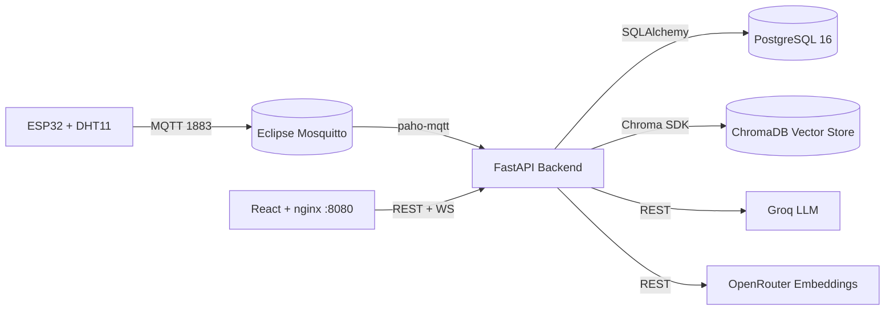

# MedAssist AI

> Intelligent hospital surveillance platform combining IoT ingestion (ESP32/MQTT), a relational database, a documentation-grounded AI assistant (RAG + ChromaDB), and a real-time dashboard — developed as part of an internship at **CHU Mohammed VI d'Oujda**.

<p align="center">
  
</p>

<p align="center">
  <a href="https://fastapi.tiangolo.com/"></a>
  <a href="https://react.dev/"></a>
  <a href="https://www.postgresql.org/"></a>
  <a href="https://www.docker.com/"></a>
  <a href="LICENSE"></a>
</p>

---

## :wave: Overview

**MedAssist AI** centralises environmental and physiological data from hospital rooms, automatically detects anomalies (temperature, humidity, pressure, air quality), and assists the staff via an AI chatbot grounded in internal protocols.

It is a self-contained, dockerised stack — frontend SPA, FastAPI backend, PostgreSQL, Mosquitto MQTT broker, ChromaDB vector store, and an ESP32 firmware that ships sensor data over Wi-Fi.

---

## :sparkles: Features

- :hospital: **Real-time room dashboard** — live measurements, 24h / 7d / 30d trends, status per sensor
- :rotating_light: **Anomaly detection & alerts** — automatic threshold checks with two severity levels (`attention`, `critique`)
- :robot: **RAG-powered AI assistant** — answers grounded in your hospital's own PDF protocols, in French
- :brain: **Explainable alerts** — every alert is annotated with a 3-part explanation (*Why / Risks / Action*), cached for 24h
- :satellite: **ESP32 ingestion** — sensors publish over MQTT; unknown IPs are kept aside for an admin to claim
- :closed_lock_with_key: **Role-based access** — `admin`, `hospital_staff`, `visitor` with JWT auth

---

## :building_construction: Architecture



A complete walkthrough lives in [`docs/architecture.md`](docs/architecture.md).

---

## :rocket: Quick Start

```bash
# 1. Clone
git clone https://github.com/t4lhawi/MedAssist-AI.git
cd MedAssist-AI

# 2. Configure
cp .env.example .env
# Edit .env: POSTGRES_PASSWORD, SECRET_KEY, GROQ_API_KEY, OPENROUTER_API_KEY

# 3. Run
docker compose up -d --build
```

| Service        | URL                            |
| -------------- | ------------------------------ |
| Web app        | http://localhost:8080          |
| API / Swagger  | http://localhost:8000/docs     |
| Health check   | http://localhost:8000/health   |
| MQTT broker    | `mqtt://localhost:1883`        |

### Default accounts (development)

| Role            | Email                 | Password         |
| --------------- | --------------------- | ---------------- |
| `admin`         | admin@chuoujda.ma     | `Admin@2026!`    |
| `hospital_staff`| staff@chuoujda.ma     | `Staff@2026!`    |
| `visitor`       | visitor@chuoujda.ma   | `Visitor@2026!`  |

> :warning: Change all default credentials before any non-development deployment.

Full instructions in [`docs/deployment.md`](docs/deployment.md).

---

## :books: Documentation

| Document                                            | What's inside                                     |
| --------------------------------------------------- | ------------------------------------------------- |
| [docs/README.md](docs/README.md)                    | Documentation home and navigation                 |
| [docs/architecture.md](docs/architecture.md)        | Components, communication, AI pipeline            |
| [docs/api.md](docs/api.md)                          | Every REST + WebSocket endpoint                   |
| [docs/database.md](docs/database.md)                | ER diagram, tables, columns, relationships        |
| [docs/rag.md](docs/rag.md)                          | Document ingestion, retrieval, prompts           |
| [docs/firmware.md](docs/firmware.md)                | ESP32 sketch, Wi-Fi, MQTT, reconnection logic     |
| [docs/deployment.md](docs/deployment.md)            | Docker, environment, production checklist         |
| [docs/security.md](docs/security.md)                | JWT, hashing, RBAC, CORS                          |
| [docs/troubleshooting.md](docs/troubleshooting.md)  | Common issues and fixes                           |

---

## :hammer_and_wrench: Tech Stack

| Layer            | Technology                                          |
| ---------------- | --------------------------------------------------- |
| Frontend         | React 18 · Vite · TypeScript · Tailwind · Recharts  |
| Backend          | Python 3.11 · FastAPI 0.111 · SQLAlchemy 2 · Alembic |
| Database         | PostgreSQL 16                                       |
| IoT broker       | Eclipse Mosquitto 2                                 |
| Vector store     | ChromaDB                                            |
| LLM              | Groq (`llama-3.3-70b-versatile`)                    |
| Embeddings       | OpenRouter (`nvidia/llama-nemotron-embed-vl-1b-v2`) |
| Firmware         | Arduino / ESP32 (DHT11)                             |
| Orchestration    | Docker Compose                                      |

---

## :handshake: Contributing

Pull requests are welcome. For substantial changes, please open an issue first to discuss what you would like to change.

---

## :scroll: License

This project is licensed under the **MIT License** — see the [LICENSE](LICENSE) file.

```
MIT License
Copyright (c) 2026 Mohamed Talhaoui
```

---

## :bust_in_silhouette: Author

**Mohamed Talhaoui** — [github.com/t4lhawi](https://github.com/t4lhawi) · t4lhawi@gmail.com

<p align="center">Internship project delivered for the <strong>CHU Mohammed VI d'Oujda</strong> · 2026</p>
