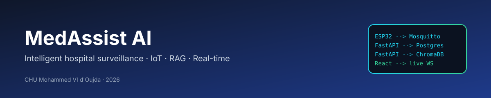
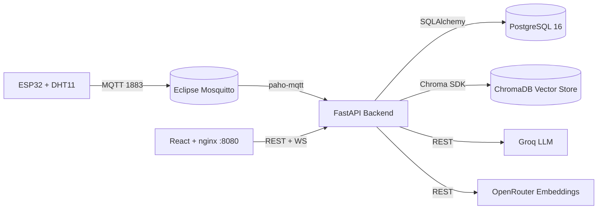

# MedAssist AI

> Plateforme de surveillance hospitalière intelligente combinant l'ingestion IoT (ESP32/MQTT), une base de données relationnelle, un assistant IA documentaire (RAG + ChromaDB) et un tableau de bord temps réel — développée dans le cadre d'un stage au **CHU Mohammed VI d'Oujda**.

<p align="center">
  
</p>

<p align="center">
  <a href="https://fastapi.tiangolo.com/"></a>
  <a href="https://react.dev/"></a>
  <a href="https://www.postgresql.org/"></a>
  <a href="https://www.docker.com/"></a>
  <a href="LICENSE"></a>
</p>

---

## Aperçu

**MedAssist AI** centralise les données environnementales et physiologiques des salles hospitalières, détecte automatiquement les anomalies (température, humidité, pression, qualité de l'air) et assiste le personnel via un assistant conversationnel IA fondé sur les protocoles internes.

Il s'agit d'une stack dockerisée, autonome — frontend SPA, backend FastAPI, PostgreSQL, broker MQTT Mosquitto, vector store ChromaDB, et un firmware ESP32 qui pousse les données des capteurs par Wi-Fi.

---

## Fonctionnalités

- **Tableau de bord temps réel par salle** — mesures en direct, tendances 24 h / 7 j / 30 j, état par capteur
- **Détection d'anomalies et alertes** — vérification automatique des seuils avec deux niveaux de sévérité (`attention`, `critique`)
- **Assistant IA RAG** — réponses fondées sur les protocoles PDF internes de l'hôpital, en français
- **Alertes explicables** — chaque alerte est annotée d'une explication en trois volets (*Pourquoi / Risques / Action*), mise en cache 24 h
- **Ingestion ESP32** — les capteurs publient via MQTT ; les IP inconnues sont conservées à part pour revendication par un administrateur
- **Contrôle d'accès par rôles** — `admin`, `hospital_staff`, `visitor` avec authentification JWT

---

## Architecture



Une description complète est disponible dans [`docs/architecture.md`](docs/architecture.md).

---

## Démarrage rapide

```bash
# 1. Cloner le dépôt
git clone https://github.com/t4lhawi/MedAssist-AI.git
cd MedAssist-AI

# 2. Configurer
cp .env.example .env
# Éditer .env : POSTGRES_PASSWORD, SECRET_KEY, GROQ_API_KEY, OPENROUTER_API_KEY

# 3. Lancer
docker compose up -d --build
```

| Service        | URL                            |
| -------------- | ------------------------------ |
| Application    | http://localhost:8080          |
| API / Swagger  | http://localhost:8000/docs     |
| Health check   | http://localhost:8000/health   |
| Broker MQTT    | `mqtt://localhost:1883`        |

### Comptes par défaut (développement)

| Rôle             | Email                 | Mot de passe      |
| ---------------- | --------------------- | ----------------- |
| `admin`          | admin@chuoujda.ma     | `Admin@2026!`     |
| `hospital_staff` | staff@chuoujda.ma     | `Staff@2026!`     |
| `visitor`        | visitor@chuoujda.ma   | `Visitor@2026!`   |

> **Avertissement :** changez impérativement tous les mots de passe par défaut avant tout déploiement hors développement.

Les instructions complètes sont dans [`docs/deployment.md`](docs/deployment.md).

---

## Documentation

| Document                                            | Contenu                                       |
| --------------------------------------------------- | --------------------------------------------- |
| [docs/README.md](docs/README.md)                    | Accueil et navigation de la documentation     |
| [docs/architecture.md](docs/architecture.md)        | Composants, communication, pipeline IA        |
| [docs/api.md](docs/api.md)                          | Tous les endpoints REST + WebSocket           |
| [docs/database.md](docs/database.md)                | Diagramme ER, tables, colonnes, relations     |
| [docs/rag.md](docs/rag.md)                          | Ingestion, retrieval, prompts                 |
| [docs/firmware.md](docs/firmware.md)                | Sketch ESP32, Wi-Fi, MQTT, reconnexion        |
| [docs/deployment.md](docs/deployment.md)            | Docker, environnement, checklist production   |
| [docs/security.md](docs/security.md)                | JWT, hachage, RBAC, CORS                      |
| [docs/troubleshooting.md](docs/troubleshooting.md)  | Problèmes courants et solutions               |

---

## Stack technique

| Couche            | Technologie                                          |
| ----------------- | ---------------------------------------------------- |
| Frontend          | React 18 · Vite · TypeScript · Tailwind · Recharts   |
| Backend           | Python 3.11 · FastAPI 0.111 · SQLAlchemy 2 · Alembic |
| Base de données   | PostgreSQL 16                                        |
| Broker IoT        | Eclipse Mosquitto 2                                  |
| Vector store      | ChromaDB                                             |
| LLM               | Groq (`llama-3.3-70b-versatile`)                     |
| Embeddings        | OpenRouter (`nvidia/llama-nemotron-embed-vl-1b-v2`)  |
| Firmware          | Arduino / ESP32 (DHT11)                              |
| Orchestration     | Docker Compose                                       |

---

## Contribution

Les pull requests sont les bienvenus. Pour des modifications substantielles, ouvrez d'abord une issue pour en discuter.

---

## Licence

Ce projet est sous licence **MIT** — voir le fichier [LICENSE](LICENSE).

```
MIT License
Copyright (c) 2026 Mohamed Talhaoui
```

---

## Auteur

**Mohamed Talhaoui** — [github.com/t4lhawi](https://github.com/t4lhawi) · t4lhawi@gmail.com

<p align="center">Projet de stage réalisé pour le <strong>CHU Mohammed VI d'Oujda</strong> · 2026</p>
