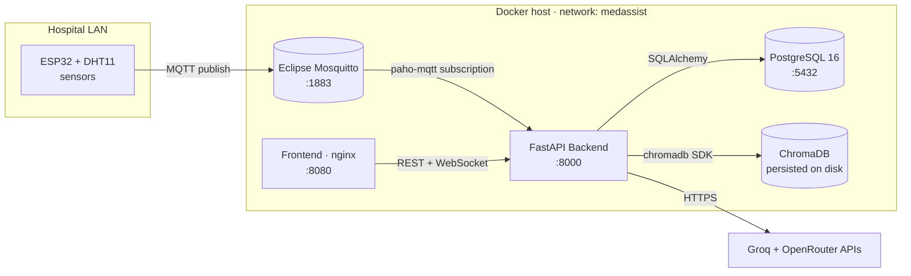
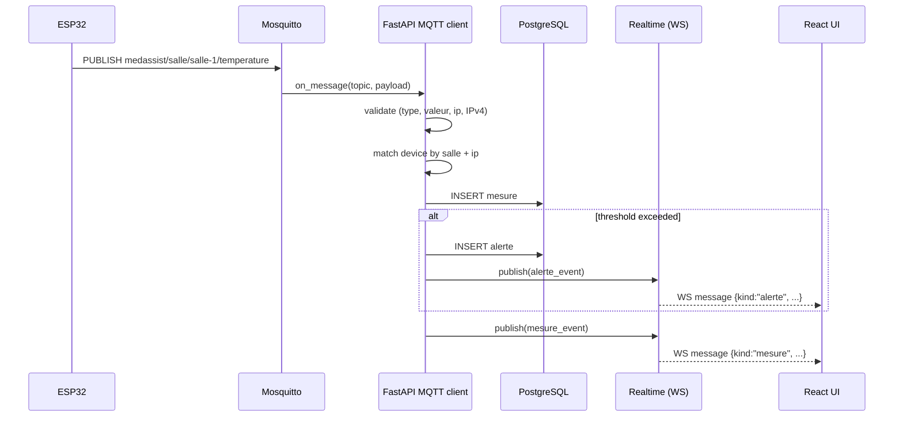
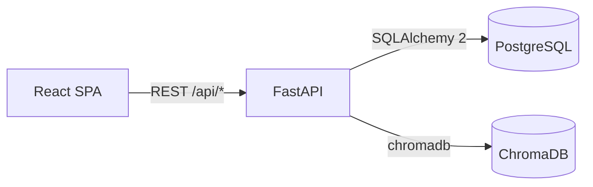
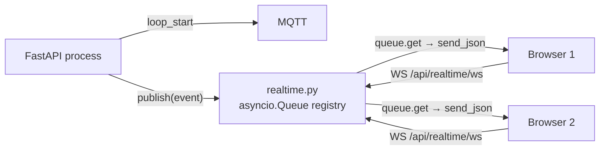
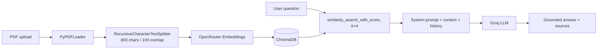

# :building_construction: Architecture

> How MedAssist AI is wired together — from the ESP32 sensor on a hospital wall to the React dashboard in a staff browser.

---

## :mag: High-level overview

MedAssist AI is a **multi-service, containerised platform**. The runtime topology is:



**One-line mental model:** *ESP32 → MQTT → FastAPI → PostgreSQL + ChromaDB → REST/WS → React.*

---

## :bricks: Components & Responsibilities

| Component                | Tech                              | Responsibility                                                                                   |
| ------------------------ | --------------------------------- | ------------------------------------------------------------------------------------------------ |
| **ESP32 firmware**       | Arduino, `PubSubClient`, `DHTesp` | Read DHT11 sensor, publish JSON on MQTT every 3 s                                                |
| **Mosquitto broker**     | Eclipse Mosquitto 2               | IoT pub/sub bus, no-auth listener on `1883`                                                      |
| **FastAPI backend**      | Python 3.11, Uvicorn              | MQTT ingestion, REST + WebSocket API, AI pipeline, scheduler, sweeper                            |
| **PostgreSQL**           | PostgreSQL 16                     | Source of truth: users, devices, mesures, alertes, documents, conversations                      |
| **ChromaDB**             | ChromaDB (persistent)             | Vector store for RAG (`medassist_docs` collection)                                               |
| **Frontend**             | React 18, Vite, Tailwind, Recharts | Dashboard UI, real-time charts, alert management, chat, admin panel                            |
| **Groq**                 | SaaS LLM API                      | Chat completions (used by RAG and alert explanations)                                            |
| **OpenRouter**           | SaaS embeddings API               | Text embeddings for ChromaDB                                                                    |

---

## :satellite: MQTT Communication

**Broker:** Eclipse Mosquitto 2, anonymous listener, exposed on the Docker host (`0.0.0.0:1883`) so LAN devices can reach it.

**Topic shape:**

```
<MQTT_TOPIC_PREFIX>/<salle>/<type>
        ↓              ↓        ↓
  medassist/salle / salle-1 / temperature
```

The default prefix is `medassist/salle`. The **topic is the source of truth** for `salle` (room). The firmware embeds its room name in the topic, and the payload's `type` is validated against the topic segment.

**Subscription:** the backend subscribes once at startup to `<prefix>/+/+` (all rooms, all sensor types).

**Payload (JSON):**

```json
{
  "ip":     "192.168.1.50",
  "type":   "temperature",
  "valeur": 22.4,
  "unite":  "°C"
}
```

**Ingestion flow:**



**Unregistered source IPs:** if no `Esp32Device` matches the `salle` segment, the measure is still stored (with `esp32_id=NULL`). An admin can later claim it via `POST /api/admin/esp32/claim` — the system then back-fills the link.

---

## :globe_with_meridians: REST API

The backend exposes a versioned REST API under `/api/...`. All authenticated endpoints expect a Bearer JWT (`Authorization: Bearer <token>`).



Mounted routers (from `backend/app/main.py`):

| Router              | Prefix                | Purpose                                              |
| ------------------- | --------------------- | ---------------------------------------------------- |
| `auth`              | `/api/auth`           | Login, register, current user                        |
| `capteurs` (legacy) | `/api/capteurs`       | Backward-compatible list of ESP32 devices            |
| `mesures`           | `/api/mesures`        | Paginated measurement history                        |
| `alertes`           | `/api/alertes`        | List, mark handled, delete alerts                    |
| `documents`         | `/api/documents`      | Upload / list / download / rename / delete PDFs      |
| `chat`              | `/api/chat`           | RAG chat, history, interpretation of measurements    |
| `admin_esp32`       | `/api/admin/esp32`    | Admin device registry + claim unregistered sources   |
| `realtime`          | `/api/realtime/ws`    | WebSocket live stream                                |

Every endpoint is fully documented in [`api.md`](api.md).

---

## :satellite_antenna: WebSocket — Realtime stream

A single WebSocket endpoint, `GET /api/realtime/ws?token=<JWT>`, pushes a stream of `mesure` and `alerte` events to authenticated clients.

**How it works:**



- The MQTT callback runs on a paho-mqtt thread and pushes into the registry via `loop.call_soon_threadsafe`.
- Each connected client owns one bounded `asyncio.Queue` (size 256). Slow consumers have their events dropped (no back-pressure).
- The handshake sends a `{"kind":"hello", "user":...}` frame so the client can flip its UI to *live*.
- JWT is passed as a query parameter (browsers can't set headers on the WS handshake).

---

## :elephant: PostgreSQL

The relational store. Six tables (`utilisateurs`, `esp32_devices`, `mesures`, `alertes`, `documents`, `conversations`) are defined as SQLAlchemy 2 models and migrated through **Alembic**. See [`database.md`](database.md) for the full schema, ER diagram, and relationships.

---

## :card_file_box: ChromaDB

A local, persistent ChromaDB instance (`CHROMA_PATH=/data/chroma`, collection `medassist_docs`) stores one document per uploaded PDF, split into chunks. The retrieval pipeline is documented in detail in [`rag.md`](rag.md).

---

## :robot: AI pipeline (RAG)



Two LLM-driven features are wired up on top:

- **Chat** (`POST /api/chat`) — answers grounded in PDF chunks, in French, with citations.
- **Alert explanation** (`expliquer_alerte`) — every new alert is annotated with a 3-part markdown explanation (*Why / Risks / Action*), cached for 24h to limit LLM cost.

> :information_source: The chat endpoint will refuse to invent medical information: if the question isn't covered by the indexed documents, the assistant replies that the information is not in the available documents.

---

## :whale: Docker architecture

`docker-compose.yml` orchestrates four services on a private bridge network `medassist`:

```mermaid
flowchart TB
  subgraph Compose[docker-compose stack]
    PG[postgres:16-alpine<br/>volume: pgdata]
    MQ[eclipse-mosquitto:2<br/>volume: mqttdata<br/>port 1883→host]
    BK[backend (python:3.11-slim)<br/>port 8000→host<br/>volume: medassist-data → /data]
    FE[frontend (nginx)<br/>port 8080→host]
  end

  BK -- depends_on: healthy --> PG
  BK -- depends_on: started --> MQ
  FE -- depends_on: started --> BK
```

**Startup order:**

1. `postgres` starts and becomes *healthy* (`pg_isready`).
2. `mosquitto` starts.
3. `backend` starts. Its `entrypoint.sh` waits for Postgres, runs `alembic upgrade head`, runs `seed_roles.py`, then launches Uvicorn.
4. `frontend` starts once the backend is *started* (not health-checked, so use `/health` if you need stricter orchestration).

> :bulb: Three volumes persist data across restarts: `pgdata` (Postgres), `mqttdata` (Mosquitto persistence), `medassist-data` (ChromaDB + uploaded PDFs).

---

## :arrows_counterclockwise: Background tasks (lifespan)

The FastAPI `lifespan` context manager starts two background loops:

- **MQTT ingestion** — `MqttIngestClient.start()` (`paho-mqtt` network loop on a thread).
- **Alert sweeper** — every hour, deletes untreated alerts older than 24 h (`purge_old_alertes`).

Both are cleanly cancelled on shutdown (`mqtt_client.stop()` + `task.cancel()`).

---

## :shield: Cross-cutting concerns

| Concern         | Where                                                                                |
| --------------- | ------------------------------------------------------------------------------------ |
| Authentication  | JWT HS256, 60-min TTL, dependency `get_current_user`                                 |
| Authorization   | Role guards: `require_admin`, `require_hospital_staff`, `require_roles(...)`         |
| CORS            | `CORSMiddleware`, origins include `localhost:5173` and `localhost:3000`, wildcard   |
| Config          | Pydantic `Settings` from `.env`                                                      |
| Logging         | `logging.getLogger(__name__)` per module                                             |
| Concurrency     | MQTT thread → asyncio thread-safe handoff via `call_soon_threadsafe`                 |

See [`security.md`](security.md) for hardening notes.
