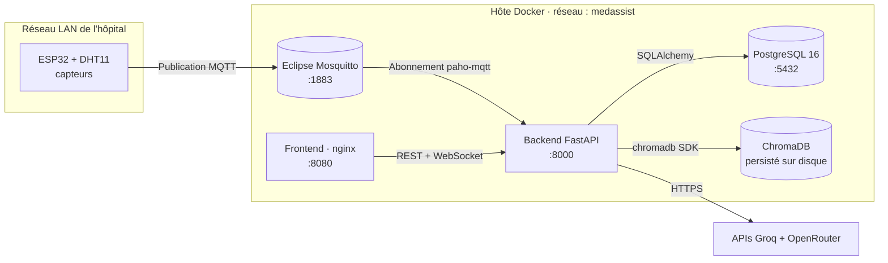
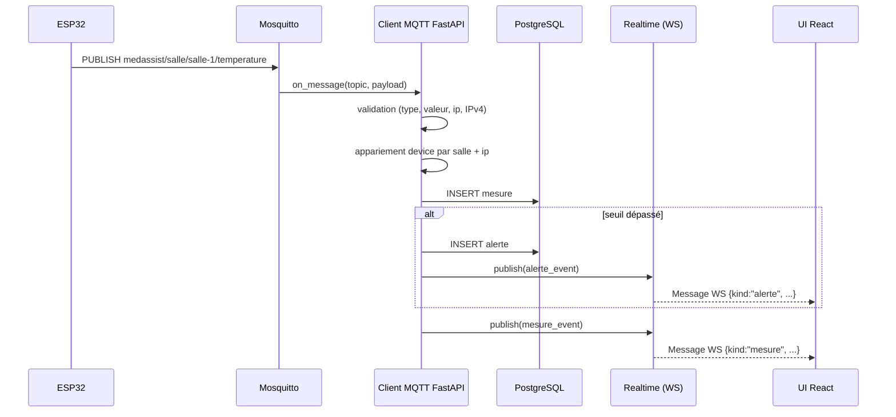
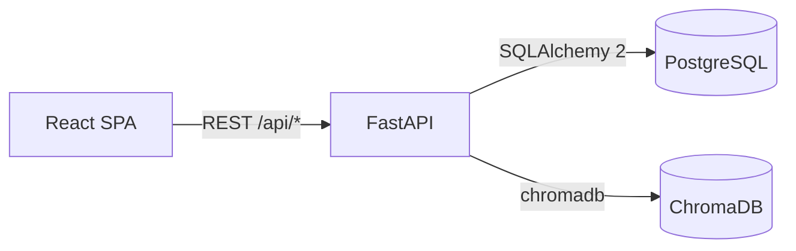
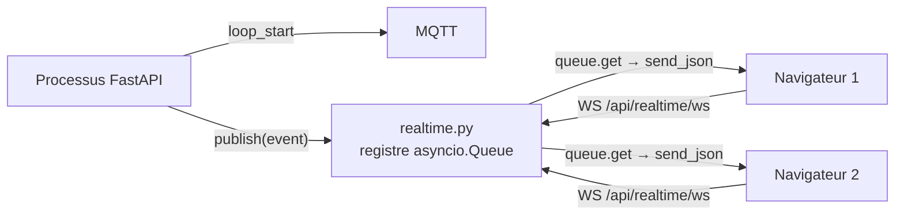
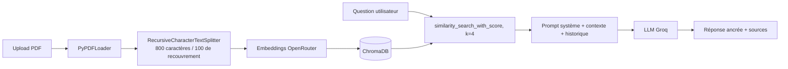
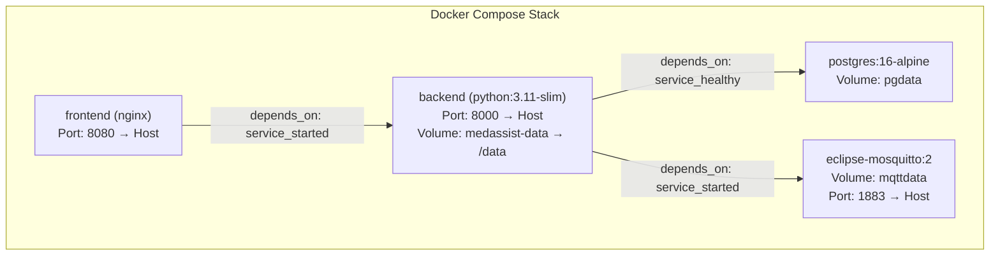

# Architecture

> Comment MedAssist AI est assemblé — du capteur ESP32 sur un mur d'hôpital jusqu'au tableau de bord React dans le navigateur du personnel.

---

## Vue d'ensemble

MedAssist AI est une **plateforme multi-services conteneurisée**. La topologie d'exécution est :



**Modèle mental en une phrase :** *ESP32 → MQTT → FastAPI → PostgreSQL + ChromaDB → REST/WS → React.*

---

## Composants et responsabilités

| Composant               | Technologie                          | Responsabilité                                                                                |
| ----------------------- | ------------------------------------ | --------------------------------------------------------------------------------------------- |
| **Firmware ESP32**      | Arduino, `PubSubClient`, `DHTesp`    | Lit le capteur DHT11, publie un JSON sur MQTT toutes les 3 s                                  |
| **Broker Mosquitto**    | Eclipse Mosquitto 2                  | Bus pub/sub IoT, listener sans authentification sur `1883`                                    |
| **Backend FastAPI**     | Python 3.11, Uvicorn                 | Ingestion MQTT, API REST + WebSocket, pipeline IA, planificateur, sweeper                     |
| **PostgreSQL**          | PostgreSQL 16                        | Source de vérité : utilisateurs, devices, mesures, alertes, documents, conversations          |
| **ChromaDB**            | ChromaDB (persistent)                | Vector store pour le RAG (collection `medassist_docs`)                                         |
| **Frontend**            | React 18, Vite, Tailwind, Recharts   | UI tableau de bord, graphiques temps réel, gestion des alertes, chat, panneau admin           |
| **Groq**                | API LLM SaaS                         | Chat completions (utilisé par le RAG et l'explication des alertes)                            |
| **OpenRouter**          | API d'embeddings SaaS                | Embeddings de texte pour ChromaDB                                                             |

---

## Communication MQTT

**Broker :** Eclipse Mosquitto 2, listener anonyme, exposé sur l'hôte Docker (`0.0.0.0:1883`) pour que les devices du LAN puissent l'atteindre.

**Forme du topic :**

```
<MQTT_TOPIC_PREFIX>/<salle>/<type>
        ↓              ↓        ↓
  medassist/salle / salle-1 / temperature
```

Le préfixe par défaut est `medassist/salle`. **Le topic fait foi** pour la `salle` (room). Le firmware embarque le nom de la salle dans le topic, et le `type` du payload est validé contre le segment de topic.

**Abonnement :** au démarrage, le backend souscrit une fois à `<prefix>/+/+` (toutes les salles, tous les types).

**Payload (JSON) :**

```json
{
  "ip":     "192.168.1.50",
  "type":   "temperature",
  "valeur": 22.4,
  "unite":  "°C"
}
```

**Flux d'ingestion :**



**IP sources non enregistrées :** si aucun `Esp32Device` ne correspond au segment `salle`, la mesure est quand même stockée (avec `esp32_id=NULL`). Un administrateur peut ensuite la revendiquer via `POST /api/admin/esp32/claim` — le système rebascule alors les liens.

---

## API REST

Le backend expose une API REST versionnée sous `/api/...`. Tous les endpoints authentifiés attendent un JWT Bearer (`Authorization: Bearer <token>`).



Routers montés (extrait de `backend/app/main.py`) :

| Router              | Préfixe               | Rôle                                              |
| ------------------- | --------------------- | ------------------------------------------------- |
| `auth`              | `/api/auth`           | Login, register, utilisateur courant              |
| `capteurs` (legacy) | `/api/capteurs`       | Liste rétro-compatible des devices ESP32          |
| `mesures`           | `/api/mesures`        | Historique paginé des mesures                     |
| `alertes`           | `/api/alertes`        | Liste, marquer traitée, supprimer                |
| `documents`         | `/api/documents`      | Upload / list / download / renommer / supprimer   |
| `chat`              | `/api/chat`           | Chat RAG, historique, interprétation de mesures   |
| `admin_esp32`       | `/api/admin/esp32`    | Registre devices admin + revendication IP         |
| `realtime`          | `/api/realtime/ws`    | Flux temps réel WebSocket                         |

Chaque endpoint est entièrement documenté dans [`api.md`](api.md).

---

## WebSocket — Flux temps réel

Un unique endpoint WebSocket, `GET /api/realtime/ws?token=<JWT>`, pousse un flux d'événements `mesure` et `alerte` aux clients authentifiés.

**Fonctionnement :**



- Le callback MQTT s'exécute sur un thread paho-mqtt et pousse dans le registre via `loop.call_soon_threadsafe`.
- Chaque client connecté possède une `asyncio.Queue` bornée (taille 256). Les événements des clients lents sont supprimés (pas de back-pressure).
- Le handshake envoie une trame `{"kind":"hello", "user":...}` pour que le client puisse basculer son UI sur *live*.
- Le JWT est passé en query parameter (les navigateurs ne peuvent pas définir d'en-têtes sur le handshake WS).

---

## PostgreSQL

Le store relationnel. Six tables (`utilisateurs`, `esp32_devices`, `mesures`, `alertes`, `documents`, `conversations`) sont définies comme modèles SQLAlchemy 2 et migrées via **Alembic**. Voir [`database.md`](database.md) pour le schéma complet, le diagramme ER et les relations.

---

## ChromaDB

Une instance ChromaDB locale et persistante (`CHROMA_PATH=/data/chroma`, collection `medassist_docs`) stocke un document par PDF uploadé, découpé en chunks. Le pipeline de retrieval est documenté en détail dans [`rag.md`](rag.md).

---

## Pipeline IA (RAG)



Deux fonctionnalités pilotées par LLM sont branchées par-dessus :

- **Chat** (`POST /api/chat`) — réponses ancrées dans les chunks de PDF, en français, avec citations.
- **Explication d'alerte** (`expliquer_alerte`) — chaque nouvelle alerte est annotée d'une explication markdown en 3 volets (*Pourquoi / Risques / Action*), mise en cache 24 h pour limiter le coût LLM.

> **Note :** l'endpoint de chat refusera d'inventer une information médicale : si la question n'est pas couverte par les documents indexés, l'assistant indique que l'information ne figure pas dans les documents disponibles.

---

## Architecture Docker

`docker-compose.yml` orchestre quatre services sur un réseau bridge privé `medassist` :



**Ordre de démarrage :**

1. `postgres` démarre et devient *healthy* (`pg_isready`).
2. `mosquitto` démarre.
3. `backend` démarre. Son `entrypoint.sh` attend Postgres, exécute `alembic upgrade head`, lance `seed_roles.py`, puis démarre Uvicorn.
4. `frontend` démarre une fois que le backend est *started* (non health-checked — utilisez `/health` pour une orchestration plus stricte).

> **Astuce :** trois volumes persistent les données au-delà des redémarrages : `pgdata` (Postgres), `mqttdata` (persistance Mosquitto), `medassist-data` (ChromaDB + PDFs uploadés).

---

## Tâches d'arrière-plan (lifespan)

Le context manager `lifespan` de FastAPI démarre deux boucles d'arrière-plan :

- **Ingestion MQTT** — `MqttIngestClient.start()` (boucle réseau paho-mqtt sur un thread).
- **Sweeper d'alertes** — toutes les heures, supprime les alertes non traitées de plus de 24 h (`purge_old_alertes`).

Les deux sont annulées proprement à l'arrêt (`mqtt_client.stop()` + `task.cancel()`).

---

## Préoccupations transverses

| Préoccupation      | Emplacement                                                                            |
| ------------------ | -------------------------------------------------------------------------------------- |
| Authentification   | JWT HS256, TTL 60 min, dépendance `get_current_user`                                   |
| Autorisation       | Gardes par rôle : `require_admin`, `require_hospital_staff`, `require_roles(...)`      |
| CORS               | `CORSMiddleware`, origines incluant `localhost:5173` et `localhost:3000`, wildcard     |
| Configuration      | `Settings` Pydantic depuis `.env`                                                      |
| Logging            | `logging.getLogger(__name__)` par module                                               |
| Concurrence        | Thread MQTT → handoff thread-safe asyncio via `call_soon_threadsafe`                  |

Voir [`security.md`](security.md) pour les notes de durcissement.
