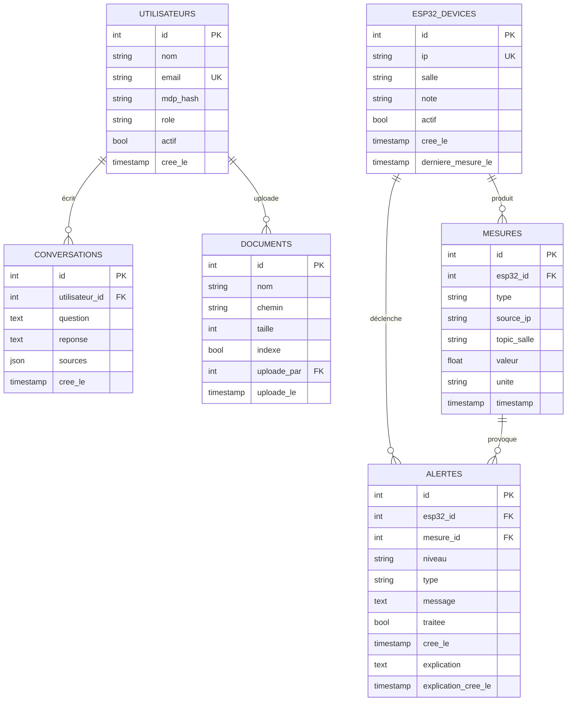

# Base de données

> Référence du schéma PostgreSQL 16 utilisé par MedAssist AI.

Le schéma est géré avec **SQLAlchemy 2** comme ORM et **Alembic** comme outil de migration. Les migrations se trouvent dans [`backend/alembic/versions/`](https://github.com/t4lhawi/MedAssist-AI/tree/main/backend/alembic/versions).

---

## Diagramme Entité-Association



---

## Tables

### `utilisateurs`

Utilisateurs de l'application. Les rôles sont normalisés vers l'une des valeurs : `admin`, `hospital_staff`, `visitor`. Les chaînes de rôle legacy (`Admin`, `Soignant`, `Technicien`, `Patient`, `Visiteur`) sont remappées à la frontière dans `auth.normalize_role`.

| Colonne    | Type                     | Contraintes                | Description                                    |
| ---------- | ------------------------ | -------------------------- | ---------------------------------------------- |
| `id`       | `Integer`                | **PK**, indexé             | Clé primaire surrogate                         |
| `nom`      | `String(100)`            | NOT NULL                   | Nom affiché                                    |
| `email`    | `String(150)`            | NOT NULL, **UNIQUE**, idx  | Identifiant de login                           |
| `mdp_hash` | `String(255)`            | NOT NULL                   | `sha256$<bcrypt>`                              |
| `role`     | `String(30)`             | défaut `visitor`           | `admin` \| `hospital_staff` \| `visitor`       |
| `actif`    | `Boolean`                | défaut `true`              | Drapeau de désactivation douce                 |
| `cree_le`  | `DateTime(timezone=True)`| server default `now()`     | Timestamp de création                          |

---

### `esp32_devices`

Registre source-de-vérité des devices. Une ligne par ESP32 physique.

| Colonne              | Type                     | Contraintes                  | Description                                                |
| -------------------- | ------------------------ | ---------------------------- | ---------------------------------------------------------- |
| `id`                 | `Integer`                | **PK**, indexé               | Clé primaire surrogate                                     |
| `ip`                 | `String(45)`             | NOT NULL, **UNIQUE**, idx    | IPv4 (ou futur IPv6) du device                             |
| `salle`              | `String(100)`            | NOT NULL, indexé             | Nom de la salle — pilote le parsing des topics             |
| `note`               | `String(200)`            | nullable                     | Note libre pour l'opérateur                                |
| `actif`              | `Boolean`                | défaut `true`                | Drapeau de désactivation douce                              |
| `cree_le`            | `DateTime(timezone=True)`| server default `now()`       | Timestamp de création                                      |
| `derniere_mesure_le` | `DateTime(timezone=True)`| nullable                     | Mis à jour à chaque mesure correspondante stockée         |

---

### `mesures`

Time-series de relevés capteurs. `esp32_id` est nullable pour supporter le **seau non enregistré** — une mesure peut être stockée avant que l'administrateur ne revendique l'IP.

| Colonne        | Type                     | Contraintes                                   | Description                                                                 |
| -------------- | ------------------------ | --------------------------------------------- | --------------------------------------------------------------------------- |
| `id`           | `Integer`                | **PK**, indexé                                | Clé primaire surrogate                                                      |
| `esp32_id`     | `Integer`                | **FK → esp32_devices.id** (nullable), idx     | Device auquel la mesure est attribuée (null tant que l'admin n'a pas revendiqué l'IP) |
| `type`         | `String(30)`             | NOT NULL, indexé                              | `temperature` \| `humidite` \| `pression` \| `qualite_air`                  |
| `source_ip`    | `String(45)`             | nullable, indexé                              | IP ayant envoyé le message MQTT                                             |
| `topic_salle`  | `String(100)`            | nullable, indexé                              | Segment de salle parsé depuis le topic MQTT (source de vérité pour `salle`) |
| `valeur`       | `Float`                  | NOT NULL                                      | Valeur mesurée                                                              |
| `unite`        | `String(20)`             | nullable                                      | Chaîne d'unité (ex. `°C`, `%`, `hPa`, `ppm`)                                |
| `timestamp`    | `DateTime(timezone=True)`| server default `now()`, indexé                | Timestamp de réception côté serveur                                         |

**Index composite :** `ix_mesures_esp32_type_ts (esp32_id, type, timestamp)` — utilisé par la requête « dernière valeur par salle » et par les requêtes de tendance 24 h / 7 j / 30 j.

---

### `alertes`

Événements de dépassement de seuil, éventuellement enrichis d'une explication LLM mise en cache.

| Colonne                 | Type                     | Contraintes                                 | Description                                                  |
| ---------------------- | ------------------------ | ------------------------------------------- | ------------------------------------------------------------ |
| `id`                   | `Integer`                | **PK**, indexé                              | Clé primaire surrogate                                       |
| `esp32_id`             | `Integer`                | **FK → esp32_devices.id** (nullable), idx   | Device concerné par l'alerte                                 |
| `mesure_id`            | `Integer`                | **FK → mesures.id** (nullable)              | Mesure qui a causé l'alerte                                  |
| `niveau`               | `String(20)`             | NOT NULL                                    | `info` \| `attention` \| `critique`                          |
| `type`                 | `String(30)`             | nullable                                    | Type de capteur (`temperature`, etc.)                        |
| `message`              | `Text`                   | NOT NULL                                    | Message d'alerte lisible                                     |
| `traitee`              | `Boolean`                | défaut `false`                              | Marquée comme traitée par un membre du personnel              |
| `cree_le`              | `DateTime(timezone=True)`| server default `now()`                      | Date de création de l'alerte                                 |
| `explication`          | `Text`                   | nullable                                    | Explication LLM mise en cache (markdown)                     |
| `explication_cree_le`  | `DateTime(timezone=True)`| nullable                                    | Quand `explication` a été générée (utilisé par le cache 24 h) |

> **Note :** les alertes non traitées de plus de 24 h sont purgées par le sweeper d'arrière-plan (`purge_old_alertes`).

---

### `documents`

PDFs uploadés par les administrateurs pour être indexés dans ChromaDB. Le fichier lui-même vit sur disque (`UPLOAD_DIR`) ; la ligne porte les métadonnées.

| Colonne        | Type                     | Contraintes                            | Description                                |
| -------------- | ------------------------ | -------------------------------------- | ------------------------------------------ |
| `id`           | `Integer`                | **PK**, indexé                         | Clé primaire surrogate                     |
| `nom`          | `String(255)`            | NOT NULL                               | Nom de fichier                             |
| `chemin`       | `String(500)`            | NOT NULL                               | Chemin absolu sur disque                   |
| `taille`       | `Integer`                | nullable                               | Taille du fichier en octets                |
| `indexe`       | `Boolean`                | défaut `false`                         | `true` une fois l'indexation Chroma terminée |
| `uploade_par`  | `Integer`                | **FK → utilisateurs.id**               | Utilisateur qui a uploadé                  |
| `uploade_le`   | `DateTime(timezone=True)`| server default `now()`                 | Date d'upload                              |

---

### `conversations`

Historique du chat avec l'assistant RAG, scopé par utilisateur.

| Colonne            | Type                     | Contraintes                                 | Description                                       |
| ------------------ | ------------------------ | ------------------------------------------- | ------------------------------------------------- |
| `id`               | `Integer`                | **PK**, indexé                              | Clé primaire surrogate                            |
| `utilisateur_id`   | `Integer`                | **FK → utilisateurs.id**                    | Propriétaire de la conversation                   |
| `question`         | `Text`                   | NOT NULL                                    | Question de l'utilisateur                         |
| `reponse`          | `Text`                   | NOT NULL                                    | Réponse de l'assistant                            |
| `sources`          | `JSON`                   | défaut `[]`                                 | Chunks de documents cités                         |
| `cree_le`          | `DateTime(timezone=True)`| server default `now()`                      | Date de l'échange                                 |

---

## Clés et relations — en un coup d'œil

| Relation                          | Cardinalité | Notes                                                                |
| --------------------------------- | ----------- | -------------------------------------------------------------------- |
| `utilisateurs` → `conversations`  | 1 → N       | Un utilisateur a plusieurs conversations                             |
| `utilisateurs` → `documents`      | 1 → N       | Un utilisateur peut uploader plusieurs PDFs                          |
| `esp32_devices` → `mesures`       | 1 → N       | Les mesures peuvent être non attribuées (`esp32_id IS NULL`) jusqu'à revendication par un admin |
| `esp32_devices` → `alertes`       | 1 → N       | `esp32_id` peut aussi être null sur une alerte issue d'une mesure   |
| `mesures` → `alertes`             | 1 → N       | Une mesure peut déclencher au plus une alerte par passage            |

---

## Migrations (Alembic)

| Révision                          | Description                                                                          |
| --------------------------------- | ------------------------------------------------------------------------------------ |
| `0001_initial_post_refactor`      | Refactor : introduction de `esp32_devices`, ajout de `topic_salle`, rétro-remplissage legacy |
| `0002_add_alerte_explication`     | Ajout des colonnes `explication` et `explication_cree_le` à `alertes`               |
| `0003_rename_roles`               | Normalisation des chaînes de rôle vers la forme canonique `{admin, hospital_staff, visitor}` |

```bash
# Appliquer toutes les migrations en attente
docker compose exec backend alembic upgrade head

# Générer une nouvelle migration après un changement de modèle
docker compose exec backend alembic revision --autogenerate -m "décrire le changement"
```

---

## Notes opérationnelles

- **Sauvegardes :** `pgdata` est un volume nommé Docker. Snapshottez-le depuis l'hôte avec `docker run --rm -v medassist_pgdata:/from -v $(pwd):/to alpine tar czf /to/pgdata.tgz -C /from .`
- **Rétention des alertes :** les alertes non traitées de plus de 24 h sont auto-purgées par `_alertes_sweeper` (voir `backend/app/main.py`).
- **Cascade à la suppression d'un device :** supprimer un `esp32_device` supprime ses `mesures` et les `alertes` associées (`crud.delete_esp32`).
