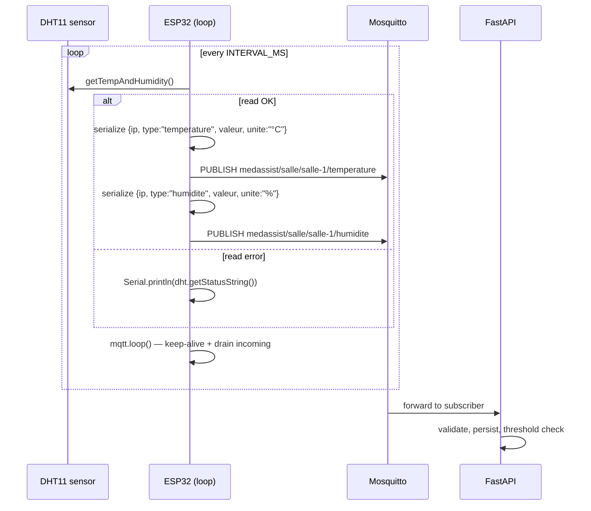

# :satellite: ESP32 Firmware

> Reference for the Arduino sketch that runs on each ESP32 sensor in the field: `firmware/firmware.ino`.

The firmware reads a **DHT11** temperature/humidity sensor and publishes measurements to the Mosquitto broker over Wi-Fi every 3 seconds. It targets the ESP32 Arduino core and uses:

- [`WiFi.h`](https://github.com/espressif/arduino-esp32) (built-in)
- [`PubSubClient.h`](https://github.com/knolleary/pubsubclient) — MQTT
- [`ArduinoJson.h`](https://arduinojson.org/) — JSON payload
- [`DHTesp.h`](https://github.com/beegee-tokyo/DHTesp) — DHT11 driver

---

## :gear: Configuration

All configuration is done by editing constants at the top of the sketch. There is no runtime configuration, no OTA, and no NVS — flashing the chip is the way to update it.

```cpp
// Identifiants Wi-Fi
const char* WIFI_SSID     = "YOUR_WIFI_SSID";
const char* WIFI_PASSWORD = "YOUR_WIFI_PASSWORD";

// Broker MQTT (IP de la machine hôte qui exécute Docker)
const char* MQTT_BROKER    = "192.168.1.100";
const int   MQTT_PORT      = 1883;
const char* MQTT_CLIENT_ID = "esp32-sensor-1";

// Salle (utilisée dans le topic MQTT)
#define SALLE "salle-1"

// Intervalle entre deux mesures
const unsigned long INTERVAL_MS = 3000;

// Broche data du DHT11
#define DHT_PIN 4
```

| Constant            | Purpose                                                                |
| ------------------- | ---------------------------------------------------------------------- |
| `WIFI_SSID`         | Wi-Fi network name                                                     |
| `WIFI_PASSWORD`     | Wi-Fi password                                                         |
| `MQTT_BROKER`       | IPv4 of the Docker host (Mosquitto is published on the host network)   |
| `MQTT_PORT`         | MQTT TCP port (default `1883`)                                         |
| `MQTT_CLIENT_ID`    | Unique per physical ESP32                                              |
| `SALLE`             | Room name — used in the topic                                          |
| `INTERVAL_MS`       | Sampling period (3 s by default)                                       |
| `DHT_PIN`           | GPIO connected to the DHT11 data line (default `4`)                    |

> :warning: `MQTT_BROKER` **must be the LAN IP of the Docker host** (e.g. `192.168.1.100`), not `localhost` and not the Mosquitto container name. The container name is not resolvable from the ESP32.

---

## :satellite_antenna: Wi-Fi

`connecterWiFi()` runs in `setup()` and is blocking until the connection succeeds:

```cpp
WiFi.setSleep(false);   // power-save can drop the MQTT handshake
WiFi.begin(WIFI_SSID, WIFI_PASSWORD);
while (WiFi.status() != WL_CONNECTED) { delay(500); Serial.print("."); }
```

`setSleep(false)` is **important**: with Wi-Fi power-save enabled, the ESP32 can sleep the radio in the middle of the MQTT `CONNECT` packet, which causes `rc=-2` (the broker never sees the CONNACK).

Before each publish, the loop also re-checks `WiFi.status()` and re-connects if needed (in `envoyerMesure`).

---

## :envelope_with_arrow: MQTT — topics & payload

### Topic shape

```
medassist/salle/<salle>/<type>
```

Where:

- `<salle>` is the value of the `SALLE` macro (e.g. `salle-1`).
- `<type>` is one of: `temperature`, `humidite`, `pression`, `qualite_air`.

The full topic prefix is built as:

```cpp
const char* MQTT_TOPIC_PREFIX = "medassist/salle/" SALLE;
// e.g. "medassist/salle/salle-1"
```

### JSON payload

```json
{
  "ip":     "192.168.1.50",
  "type":   "temperature",
  "valeur": 22.4,
  "unite":  "°C"
}
```

| Field     | Description                                              |
| --------- | -------------------------------------------------------- |
| `ip`      | The ESP32's own IPv4 — read from `WiFi.localIP()`        |
| `type`    | Sensor type, must match the topic's last segment         |
| `valeur`  | The numeric value                                        |
| `unite`   | Unit string, free-form (`°C`, `%`, `hPa`, `ppm`)         |

QoS is **0** and `retain` is **false** — measurements are real-time streams, not retained state.

---

## :repeat: Publishing process



The `setup()` function:

1. Initialises the DHT11 on `DHT_PIN`.
2. Connects to Wi-Fi (blocking).
3. Calls `diagnosticReseau()` to print the network state.
4. Configures `mqtt.setServer(MQTT_BROKER, MQTT_PORT)`.
5. Connects to MQTT (blocking, retry every 2 s).
6. Prints `MedAssist AI prêt.`

The `loop()` function:

1. Calls `mqtt.loop()` to service keep-alive PINGREQ and drain any incoming traffic.
2. Reads the DHT11.
3. If the read succeeded, calls `envoyerMesure("temperature", …)` then `envoyerMesure("humidite", …)` 200 ms apart.
4. Sleeps for `INTERVAL_MS`.

---

## :recycle: Reconnection logic

`envoyerMesure()` is defensive: before every publish, it checks both the Wi-Fi and MQTT states and reconnects if necessary:

```cpp
if (WiFi.status() != WL_CONNECTED) {
  connecterWiFi();
}
if (!mqtt.connected()) {
  connecterMQTT();
}
mqtt.loop();   // keep-alive between publications
```

`connecterMQTT()` itself loops until the connection is back:

```cpp
while (!mqtt.connected()) {
  if (mqtt.connect(MQTT_CLIENT_ID)) { … }
  else { delay(2000); }
}
```

`PubSubClient` automatically reconnects on its own with the network loop, but a publish that lands during a disconnect window would fail. The explicit re-check before each publish closes that race.

> :information_source: The broker is currently configured **without authentication** (`mosquitto -c /mosquitto-no-auth.conf`). If you enable authentication, set `MQTT_USERNAME` / `MQTT_PASSWORD` in the backend `.env` and add a `username_pw_set(...)` call to the ESP32 sketch.

---

## :microscope: Network diagnostics

`diagnosticReseau()` runs once at boot and prints the full network state to the Serial console:

```
=== DIAGNOSTIC RESEAU ===
SSID connecte        : YOUR_WIFI_SSID
RSSI                 : -52 dBm
Adresse IP ESP32     : 192.168.1.50
Salle (topic prefix) : salle-1
Masque               : 255.255.255.0
Passerelle           : 192.168.1.1
DNS primaire         : 192.168.1.1
Broker cible         : 192.168.1.100  utilise -> 192.168.1.100
Test TCP brut 1883   : OK (3 ms)
=== FIN DIAGNOSTIC ===
```

What it does:

- Prints the connected SSID, RSSI, IP, subnet, gateway, and DNS.
- If `MQTT_BROKER` is a hostname, resolves it via `WiFi.hostByName` (logs `ECHEC DNS` if it fails).
- Opens a raw `WiFiClient` TCP connection to the broker on port 1883 and reports the latency in ms.

This is the single best place to look when the ESP32 can connect to Wi-Fi but not to MQTT — the test distinguishes between *broker unreachable*, *firewall blocking port 1883*, and *MQTT-level issues*.

---

## :electric_plug: Adding more sensors

The current sketch only drives a DHT11. Additional sensors are easy to add — for each, read the value, call `envoyerMesure("type", value, "unit")`:

```cpp
// BMP280 — barometric pressure
// envoyerMesure("pression", bmp.readPressure() / 100.0, "hPa");

// SGP40 / SGP30 — air quality
// envoyerMesure("qualite_air", sgp.getVocIndex(), "ppm");
```

The `type` string must match one of the four supported sensor types (`temperature`, `humidite`, `pression`, `qualite_air`) and must match the topic's last segment — the backend treats the topic as the source of truth and overrides a mismatched payload `type`.

---

## :hammer_and_wrench: Building & flashing

1. Install the [ESP32 Arduino core](https://docs.espressif.com/projects/arduino-esp32/en/latest/installing.html).
2. Install the libraries: `PubSubClient`, `ArduinoJson`, `DHTesp` (all available via the Arduino Library Manager).
3. Open `firmware/firmware.ino` in the Arduino IDE.
4. Adjust the configuration constants.
5. Select the right board (e.g. *ESP32 Dev Module*) and the right serial port.
6. Click **Upload**.

For headless / production flashing, you can use [`esptool.py`](https://github.com/espressif/esptool) directly:

```bash
esptool.py --chip esp32 --port /dev/ttyUSB0 write_flash 0x1000 firmware.bin
```

---

## :mag: Troubleshooting

| Symptom                                | Likely cause                                                            | Fix                                                          |
| -------------------------------------- | ----------------------------------------------------------------------- | ------------------------------------------------------------ |
| Serial floods with `..................` | Wi-Fi SSID / password wrong                                             | Re-check `WIFI_SSID` and `WIFI_PASSWORD`                     |
| `MQTT publish échoué (topic=…)`        | Broker unreachable, or topic prefix not matching an admin-registered room | Confirm `diagnosticReseau` shows `Test TCP brut 1883 : OK` and the topic matches a `salle` in the admin UI |
| `rc=-2` on MQTT connect                | Radio sleeping through the handshake                                    | Make sure `WiFi.setSleep(false)` is called before `WiFi.begin` |
| `Erreur DHT11 : TIMEOUT`               | Wiring or pull-up resistor missing                                      | DHT11 needs a 10 kΩ pull-up between `DATA` and `VCC`         |
| Messages accepted but `esp32_id=null`  | The IP hasn't been claimed by an admin                                  | Use `POST /api/admin/esp32/claim` to bind the IP to a room   |
