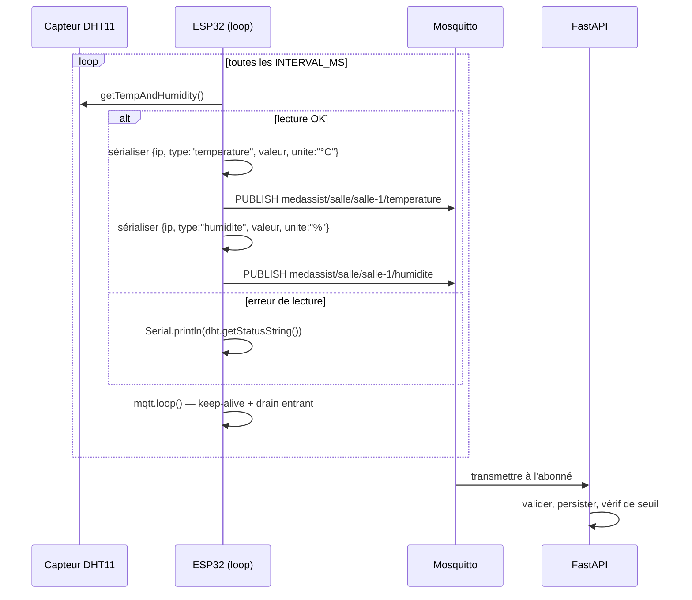

# Firmware ESP32

> Référence du sketch Arduino qui tourne sur chaque capteur ESP32 sur le terrain : `firmware/firmware.ino`.

Le firmware lit un capteur **DHT11** température/humidité et publie les mesures sur le broker Mosquitto via Wi-Fi toutes les 3 secondes. Il cible le core Arduino ESP32 et utilise :

- [`WiFi.h`](https://github.com/espressif/arduino-esp32) (intégré)
- [`PubSubClient.h`](https://github.com/knolleary/pubsubclient) — MQTT
- [`ArduinoJson.h`](https://arduinojson.org/) — Payload JSON
- [`DHTesp.h`](https://github.com/beegee-tokyo/DHTesp) — Driver DHT11

---

## Configuration

Toute la configuration se fait en éditant les constantes en haut du sketch. Il n'y a pas de configuration runtime, pas d'OTA, pas de NVS — reflasher la puce est la manière de la mettre à jour.

```cpp
// Identifiants Wi-Fi
const char* WIFI_SSID     = "YOUR_WIFI_SSID";
const char* WIFI_PASSWORD = "YOUR_WIFI_PASSWORD";

// Broker MQTT (IP de la machine hôte qui exécute Docker)
const char* MQTT_BROKER    = "192.168.1.100";
const int   MQTT_PORT      = 1883;
const char* MQTT_CLIENT_ID = "esp32-sensor-1";

// Salle (utilisée dans le topic MQTT)
#define SALLE "salle-1"

// Intervalle entre deux mesures
const unsigned long INTERVAL_MS = 3000;

// Broche data du DHT11
#define DHT_PIN 4
```

| Constante          | Rôle                                                                          |
| ------------------ | ----------------------------------------------------------------------------- |
| `WIFI_SSID`        | Nom du réseau Wi-Fi                                                           |
| `WIFI_PASSWORD`    | Mot de passe Wi-Fi                                                            |
| `MQTT_BROKER`      | IPv4 de l'hôte Docker (Mosquitto est publié sur le réseau de l'hôte)         |
| `MQTT_PORT`        | Port TCP MQTT (défaut `1883`)                                                 |
| `MQTT_CLIENT_ID`   | Unique par ESP32 physique                                                     |
| `SALLE`            | Nom de la salle — utilisé dans le topic                                       |
| `INTERVAL_MS`      | Période d'échantillonnage (3 s par défaut)                                    |
| `DHT_PIN`          | GPIO relié à la ligne de données du DHT11 (défaut `4`)                        |

> **Avertissement :** `MQTT_BROKER` **doit être l'IP LAN de l'hôte Docker** (par ex. `192.168.1.100`), pas `localhost` ni le nom du conteneur Mosquitto. Le nom du conteneur n'est pas résolvable depuis l'ESP32.

---

## Wi-Fi

`connecterWiFi()` tourne dans `setup()` et est bloquant jusqu'à ce que la connexion réussisse :

```cpp
WiFi.setSleep(false);   // le power-save peut faire tomber le handshake MQTT
WiFi.begin(WIFI_SSID, WIFI_PASSWORD);
while (WiFi.status() != WL_CONNECTED) { delay(500); Serial.print("."); }
```

`setSleep(false)` est **important** : avec le power-save Wi-Fi activé, l'ESP32 peut endormir la radio au milieu du paquet `CONNECT` MQTT, ce qui provoque `rc=-2` (le broker ne voit jamais le CONNACK).

Avant chaque publication, la boucle re-vérifie aussi `WiFi.status()` et se reconnecte si besoin (dans `envoyerMesure`).

---

## MQTT — topics et payload

### Forme du topic

```
medassist/salle/<salle>/<type>
```

Où :

- `<salle>` est la valeur de la macro `SALLE` (par ex. `salle-1`).
- `<type>` est l'un des : `temperature`, `humidite`, `pression`, `qualite_air`.

Le préfixe complet du topic est construit ainsi :

```cpp
const char* MQTT_TOPIC_PREFIX = "medassist/salle/" SALLE;
// par ex. "medassist/salle/salle-1"
```

### Payload JSON

```json
{
  "ip":     "192.168.1.50",
  "type":   "temperature",
  "valeur": 22.4,
  "unite":  "°C"
}
```

| Champ     | Description                                              |
| --------- | -------------------------------------------------------- |
| `ip`      | IPv4 de l'ESP32 lui-même — lu depuis `WiFi.localIP()`    |
| `type`    | Type de capteur, doit correspondre au dernier segment du topic |
| `valeur`  | Valeur numérique                                          |
| `unite`   | Chaîne d'unité, libre (`°C`, `%`, `hPa`, `ppm`)          |

QoS est **0** et `retain` est **false** — les mesures sont des flux temps réel, pas un état rémanent.

---

## Processus de publication



La fonction `setup()` :

1. Initialise le DHT11 sur `DHT_PIN`.
2. Se connecte au Wi-Fi (bloquant).
3. Appelle `diagnosticReseau()` pour afficher l'état réseau.
4. Configure `mqtt.setServer(MQTT_BROKER, MQTT_PORT)`.
5. Se connecte au MQTT (bloquant, retry toutes les 2 s).
6. Affiche `MedAssist AI prêt.`

La fonction `loop()` :

1. Appelle `mqtt.loop()` pour traiter les PINGREQ de keep-alive et drainer le trafic entrant.
2. Lit le DHT11.
3. Si la lecture réussit, appelle `envoyerMesure("temperature", …)` puis `envoyerMesure("humidite", …)` à 200 ms d'écart.
4. Dort pendant `INTERVAL_MS`.

---

## Logique de reconnexion

`envoyerMesure()` est défensif : avant chaque publication, il vérifie l'état du Wi-Fi et du MQTT et se reconnecte si nécessaire :

```cpp
if (WiFi.status() != WL_CONNECTED) {
  connecterWiFi();
}
if (!mqtt.connected()) {
  connecterMQTT();
}
mqtt.loop();   // keep-alive entre les publications
```

`connecterMQTT()` boucle lui-même jusqu'à ce que la connexion revienne :

```cpp
while (!mqtt.connected()) {
  if (mqtt.connect(MQTT_CLIENT_ID)) { … }
  else { delay(2000); }
}
```

`PubSubClient` se reconnecte automatiquement avec la boucle réseau, mais une publication qui tombe pendant une fenêtre de déconnexion échouerait. La revérification explicite avant chaque publication ferme cette course.

> **Note :** le broker est actuellement configuré **sans authentification** (`mosquitto -c /mosquitto-no-auth.conf`). Si vous activez l'authentification, définissez `MQTT_USERNAME` / `MQTT_PASSWORD` dans le `.env` du backend et ajoutez un appel `username_pw_set(...)` au sketch ESP32.

---

## Diagnostic réseau

`diagnosticReseau()` tourne une fois au boot et affiche l'état réseau complet sur la console Série :

```
=== DIAGNOSTIC RESEAU ===
SSID connecte        : YOUR_WIFI_SSID
RSSI                 : -52 dBm
Adresse IP ESP32     : 192.168.1.50
Salle (topic prefix) : salle-1
Masque               : 255.255.255.0
Passerelle           : 192.168.1.1
DNS primaire         : 192.168.1.1
Broker cible         : 192.168.1.100  utilise -> 192.168.1.100
Test TCP brut 1883   : OK (3 ms)
=== FIN DIAGNOSTIC ===
```

Ce qu'il fait :

- Affiche le SSID connecté, RSSI, IP, masque, passerelle, et DNS.
- Si `MQTT_BROKER` est un hostname, le résout via `WiFi.hostByName` (log `ECHEC DNS` s'il échoue).
- Ouvre une connexion TCP brute `WiFiClient` vers le broker sur le port 1883 et rapporte la latence en ms.

C'est l'endroit unique à consulter quand l'ESP32 peut se connecter au Wi-Fi mais pas au MQTT — le test distingue entre *broker injoignable*, *pare-feu bloquant le port 1883*, et *problèmes au niveau MQTT*.

---

## Ajouter d'autres capteurs

Le sketch actuel ne pilote qu'un DHT11. Des capteurs supplémentaires sont faciles à ajouter — pour chacun, lisez la valeur, appelez `envoyerMesure("type", value, "unit")` :

```cpp
// BMP280 — pression atmosphérique
// envoyerMesure("pression", bmp.readPressure() / 100.0, "hPa");

// SGP40 / SGP30 — qualité de l'air
// envoyerMesure("qualite_air", sgp.getVocIndex(), "ppm");
```

La chaîne `type` doit correspondre à l'un des quatre types supportés (`temperature`, `humidite`, `pression`, `qualite_air`) et doit correspondre au dernier segment du topic — le backend traite le topic comme source de vérité et écrase un `type` payload qui ne concorde pas.

---

## Build et flash

1. Installez l'[ESP32 Arduino core](https://docs.espressif.com/projects/arduino-esp32/en/latest/installing.html).
2. Installez les librairies : `PubSubClient`, `ArduinoJson`, `DHTesp` (toutes disponibles via le gestionnaire de librairies Arduino).
3. Ouvrez `firmware/firmware.ino` dans l'IDE Arduino.
4. Ajustez les constantes de configuration.
5. Sélectionnez la bonne carte (par ex. *ESP32 Dev Module*) et le bon port série.
6. Cliquez sur **Upload**.

Pour un flashage headless / en production, vous pouvez utiliser [`esptool.py`](https://github.com/espressif/esptool) directement :

```bash
esptool.py --chip esp32 --port /dev/ttyUSB0 write_flash 0x1000 firmware.bin
```

---

## Dépannage

| Symptôme                                | Cause probable                                                       | Correctif                                                                                |
| --------------------------------------- | -------------------------------------------------------------------- | ---------------------------------------------------------------------------------------- |
| La console série inonde de `…………`     | SSID / mot de passe Wi-Fi erronés                                    | Re-vérifiez `WIFI_SSID` et `WIFI_PASSWORD`                                              |
| `MQTT publish échoué (topic=…)`        | Broker injoignable, ou préfixe de topic ne correspondant pas à une salle admin-enregistrée | Confirmez que `diagnosticReseau` affiche `Test TCP brut 1883 : OK` et que le topic correspond à une `salle` dans l'UI admin |
| `rc=-2` sur la connexion MQTT           | Radio qui s'endort pendant le handshake                              | Assurez-vous que `WiFi.setSleep(false)` est appelé avant `WiFi.begin`                   |
| `Erreur DHT11 : TIMEOUT`                | Câblage ou résistance pull-up manquante                              | Le DHT11 nécessite une pull-up de 10 kΩ entre `DATA` et `VCC`                            |
| Messages acceptés mais `esp32_id=null`  | L'IP n'a pas été revendiquée par un admin                            | Utilisez `POST /api/admin/esp32/claim` pour rattacher l'IP à une salle                  |
