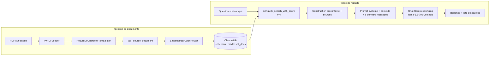
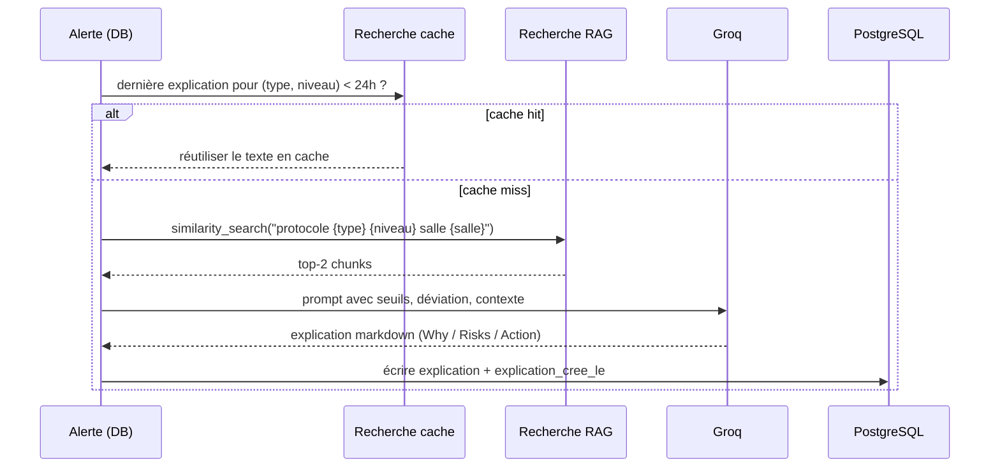

# RAG — Pipeline IA

> Comment MedAssist AI ingère les PDF de protocoles de votre hôpital, retrouve les bons chunks pour une question, et produit une réponse ancrée en français.

Le pipeline RAG (Retrieval-Augmented Generation) vit dans [`backend/app/rag/pipeline.py`](https://github.com/t4lhawi/MedAssist-AI/blob/main/backend/app/rag/pipeline.py). Il utilise **ChromaDB** comme vector store, **OpenRouter** pour les embeddings, et **Groq** pour les chat completions.

---

## Vue d'ensemble du pipeline



---

## 1. Ingestion de documents

Déclenchée par `POST /api/documents/`.

1. Le PDF est streamé vers `UPLOAD_DIR/<nom>.pdf`.
2. Une ligne `documents` est créée (`indexe=false`).
3. Une `BackgroundTask` FastAPI appelle `indexer_pdf(path, nom)`.
4. La ligne bascule à `indexe=true` une fois les chunks stockés dans Chroma.

`indexer_pdf` est également ré-utilisé lors d'un renommage (`PATCH /api/documents/{id}`) et `supprimer_document_index` retire les chunks par `source_document` lors d'une suppression.

---

## 2. Chunking

[`RecursiveCharacterTextSplitter`](https://python.langchain.com/api_reference/text_splitters/character/langchain_text_splitters.character.RecursiveCharacterTextSplitter.html) de LangChain :

| Réglage         | Valeur                          |
| --------------- | ------------------------------- |
| `chunk_size`    | **800** caractères              |
| `chunk_overlap` | **100** caractères              |
| `separators`    | `["\n\n", "\n", ".", " ", ""]`  |

Chaque chunk est étiqueté avec le champ de métadonnée `source_document = <nom_fichier>` de sorte qu'un PDF puisse être ré-indexé atomiquement.

> **Note :** les PDF vides déclenchent une erreur explicite. Les PDF scannés (image uniquement) sans texte sélectionnable échouent également — le message indique à l'utilisateur de les passer par un OCR avant de les uploader.

---

## 3. Embeddings

Les embeddings sont produits par **OpenRouter** via une petite sous-classe `Embeddings` qui appelle l'endpoint `/embeddings` compatible OpenAI.

| Réglage       | Valeur                                            |
| ------------- | ------------------------------------------------- |
| Fournisseur   | OpenRouter                                        |
| Modèle        | `nvidia/llama-nemotron-embed-vl-1b-v2:free` (configurable) |
| Batching      | Tous les chunks d'un PDF en un seul appel         |
| Endpoint      | `POST https://openrouter.ai/api/v1/embeddings`    |

Le même modèle est utilisé pour l'indexation **et** pour la vectorisation au moment de la requête — gardez-les en synchro si vous changez le modèle.

---

## 4. ChromaDB

Une instance ChromaDB locale et persistante :

| Réglage             | Valeur                                |
| ------------------- | ------------------------------------- |
| `persist_directory` | `CHROMA_PATH` (défaut `/data/chroma` en Docker) |
| `collection_name`   | `medassist_docs`                      |
| Télémétrie          | désactivée (`anonymized_telemetry=False`) |
| Mode persistance    | sur disque (`is_persistent=True`)     |

**Idempotence :** chaque appel à `indexer_pdf` commence par supprimer les chunks existants où `source_document == <nom_fichier>`, puis ré-insère. Uploader à nouveau un PDF ne laisse jamais d'orphelins.

**Nettoyage :** `_purge_null_chunks` tourne au début de chaque appel de chat pour retirer les chunks null / vides qui auraient pu être écrits par un upload partiel.

---

## 5. Recherche de similarité

Implémentée avec `vectorstore.similarity_search_with_score(question, k=RAG_RETRIEVAL_K)`.

| Réglage          | Variable env       | Défaut |
| ---------------- | ------------------ | ------ |
| Nombre de chunks | `RAG_RETRIEVAL_K`  | `4`    |

Pour chaque résultat, le chunk de document est converti en bloc de contexte :

```
Source : <nom_fichier>, page <n>
<texte du chunk>
```

Les triplets `(document, page, score)` en doublon sont retirés du tableau `sources` renvoyé au client.

---

## 6. Construction du prompt

Le prompt système impose la fidélité au contexte, les réponses en français, et la citation :

```
Tu es MedAssist AI, un assistant pour le personnel hospitalier du CHU Mohammed VI d'Oujda.
Réponds UNIQUEMENT en te basant sur les documents fournis ci-dessous.
Si l'information n'est pas dans les documents, dis clairement :
"Cette information ne figure pas dans les documents disponibles."

Règles :
- Réponds toujours en français
- Sois précis et concis
- Cite le document source à la fin de ta réponse
- N'invente jamais d'information médicale ou technique

Documents disponibles :
<context>
```

**Ordre des messages :**

1. `SystemMessage(prompt)`
2. Les `RAG_HISTORY_MESSAGES` (défaut `4`) derniers tours d'historique, en alternance `HumanMessage` / `AIMessage`.
3. Le nouveau `HumanMessage(question)`.

---

## 7. LLM (Groq)

| Réglage       | Variable env            | Défaut                            |
| ------------- | ----------------------- | --------------------------------- |
| Fournisseur   | Groq                    | Endpoint compatible OpenAI        |
| Modèle        | `LLM_MODEL`             | `llama-3.3-70b-versatile`         |
| Température   | codée en dur            | `0.1` (faible — réponses factuelles) |
| Max tokens    | `LLM_MAX_TOKENS`        | `256`                             |
| Timeout       | `LLM_TIMEOUT_SECONDS`   | `60`                              |

Le modèle est invoqué avec `ChatOpenAI(...).invoke(messages)`. Le `content` de la réponse est renvoyé tel quel comme réponse de l'assistant.

---

## 8. Génération de la réponse

La fonction `repondre(question, historique)` renvoie `(reponse: str, sources: List[dict])`.

- `reponse` — le texte de l'assistant (potentiellement vide si aucun document ne correspond).
- `sources` — `[{ "document": ..., "page": ..., "score": ... }, ...]` (une entrée par chunk cité unique).
- L'échange est persisté dans la table `conversations` par le router `chat`, avec `sources` stocké en JSON.

### Comportement de repli

Si `similarity_search` échoue (par ex. Chroma vide / indisponible), la fonction renvoie le repli convivial :

```
Aucun document n'a encore été indexé. Veuillez téléverser des documents PDF depuis la section Documents.
```

---

## Fonctionnalité adjacente : alertes explicables

`expliquer_alerte(alerte_id)` est une seconde fonctionnalité pilotée par LLM qui tourne sur chaque nouvelle alerte (dans un thread d'arrière-plan, voir `crud._schedule_explication`).



- **TTL du cache :** 24 h (`EXPLICATION_CACHE_HOURS` dans `crud.py`). Cela réduit drastiquement les appels LLM lors de tempêtes d'alertes.
- **Ancrage :** le prompt demande explicitement au modèle *de ne rien inventer* et de citer le protocole si une procédure existe.

---

## Référence de configuration

| Variable d'env         | Défaut                                | Utilisé par                |
| ---------------------- | -------------------------------------- | -------------------------- |
| `OPENROUTER_API_KEY`   | *(obligatoire)*                       | Embeddings                 |
| `EMBEDDING_MODEL`      | `nvidia/llama-nemotron-embed-vl-1b-v2:free` | Embeddings           |
| `GROQ_API_KEY`         | *(obligatoire)*                       | LLM                        |
| `LLM_MODEL`            | `llama-3.3-70b-versatile`              | LLM                        |
| `LLM_MAX_TOKENS`       | `256`                                  | LLM                        |
| `LLM_TIMEOUT_SECONDS`  | `60`                                   | LLM                        |
| `CHROMA_PATH`          | `./chroma_db` → `/data/chroma` (Docker) | Vector store              |
| `RAG_RETRIEVAL_K`      | `4`                                    | Recherche de similarité    |
| `RAG_HISTORY_MESSAGES` | `4`                                    | Fenêtre d'historique       |
| `UPLOAD_DIR`           | `./uploads` → `/data/uploads` (Docker) | Stockage PDF              |

Voir [`deployment.md`](deployment.md) pour la mise en place en production.

---

## Vérification du pipeline

1. **Uploadez un PDF** en tant qu'admin : `POST /api/documents/` avec `file=@protocol.pdf`.
2. **Attendez quelques secondes** que l'indexeur d'arrière-plan finisse (vérifiez `indexe=true` sur `GET /api/documents/`).
3. **Posez une question :** `POST /api/chat/` avec `{"question": "…", "historique": []}`.
4. **Vérifiez la réponse** — le tableau `sources` doit contenir le PDF et un numéro de page.

Si `sources` est vide :

- La question n'a aucun rapport avec le contenu indexé → repli attendu.
- Le PDF est un scan sans texte sélectionnable → ré-exportez avec OCR.
- `OPENROUTER_API_KEY` ou `GROQ_API_KEY` est manquant / erroné → vérifiez les logs du conteneur (`docker compose logs backend`).
