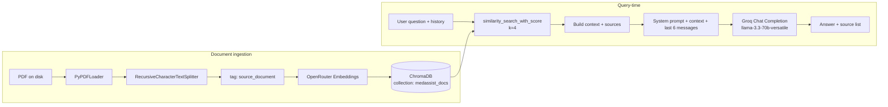
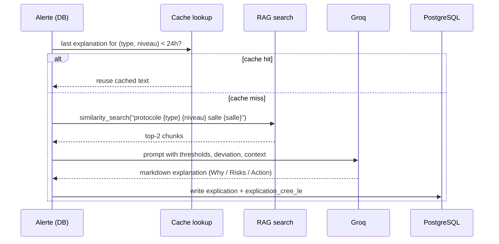

# :brain: RAG — AI Pipeline

> How MedAssist AI ingests your hospital's PDF protocols, retrieves the right chunks for a question, and produces a grounded, French-language answer.

The RAG (Retrieval-Augmented Generation) pipeline lives in [`backend/app/rag/pipeline.py`](https://github.com/t4lhawi/MedAssist-AI/blob/main/backend/app/rag/pipeline.py). It uses **ChromaDB** as a vector store, **OpenRouter** for embeddings, and **Groq** for chat completions.

---

## :sparkles: Pipeline at a glance



---

## :inbox_tray: 1. Document ingestion

Triggered by `POST /api/documents/`.

1. The PDF is streamed to `UPLOAD_DIR/<name>.pdf`.
2. A `documents` row is created (`indexe=false`).
3. A FastAPI `BackgroundTask` calls `indexer_pdf(path, name)`.
4. The row is flipped to `indexe=true` once chunks land in Chroma.

`indexer_pdf` is also re-used on rename (`PATCH /api/documents/{id}`) and on delete (`supprimer_document_index` removes chunks by `source_document`).

---

## :scissors: 2. Chunking

[`RecursiveCharacterTextSplitter`](https://python.langchain.com/api_reference/text_splitters/character/langchain_text_splitters.character.RecursiveCharacterTextSplitter.html) from LangChain:

| Setting      | Value                         |
| ------------ | ----------------------------- |
| `chunk_size` | **800** characters            |
| `chunk_overlap` | **100** characters         |
| `separators` | `["\n\n", "\n", ".", " ", ""]`|

Each chunk is tagged with the metadata field `source_document = <filename>` so a single PDF can be re-indexed atomically.

> :information_source: Empty PDFs raise an explicit error. Scanned (image-only) PDFs without selectable text also fail — the message tells the user to run them through OCR first.

---

## :abcd: 3. Embeddings

Embeddings are produced by **OpenRouter** via a small `Embeddings` subclass that calls the OpenAI-compatible `/embeddings` endpoint.

| Setting      | Value                                          |
| ------------ | ---------------------------------------------- |
| Provider     | OpenRouter                                     |
| Model        | `nvidia/llama-nemotron-embed-vl-1b-v2:free` (configurable) |
| Batching     | All chunks of one PDF in a single call         |
| Endpoint     | `POST https://openrouter.ai/api/v1/embeddings` |

The same model is used for indexing **and** for query-time vectorisation — keep them in sync if you change the model.

---

## :card_file_box: 4. ChromaDB

A persistent, on-disk ChromaDB instance:

| Setting            | Value                              |
| ------------------ | ---------------------------------- |
| `persist_directory`| `CHROMA_PATH` (default `/data/chroma` in Docker) |
| `collection_name`  | `medassist_docs`                   |
| Telemetry          | disabled (`anonymized_telemetry=False`) |
| Persistence mode   | on-disk (`is_persistent=True`)     |

**Idempotency:** every `indexer_pdf` call first deletes existing chunks where `source_document == <filename>`, then re-inserts. Re-uploading a PDF never leaves orphans.

**Cleanup:** `_purge_null_chunks` runs at the start of every chat call to remove null / empty chunks that may have been written by a partial upload.

---

## :mag: 5. Similarity search

Implemented with `vectorstore.similarity_search_with_score(question, k=RAG_RETRIEVAL_K)`.

| Setting           | Env var            | Default |
| ----------------- | ------------------ | ------- |
| Number of chunks  | `RAG_RETRIEVAL_K`  | `4`     |

For each result, the document chunk is converted into the context block:

```
Source: <filename>, page <n>
<chunk text>
```

Duplicate `(document, page, score)` triples are dropped from the `sources` array returned to the client.

---

## :speech_balloon: 6. Prompt construction

The system prompt enforces ground truth, French-language answers, and citation:

```
Tu es MedAssist AI, un assistant pour le personnel hospitalier du CHU Mohammed VI d'Oujda.
Réponds UNIQUEMENT en te basant sur les documents fournis ci-dessous.
Si l'information n'est pas dans les documents, dis clairement :
"Cette information ne figure pas dans les documents disponibles."

Règles :
- Réponds toujours en français
- Sois précis et concis
- Cite le document source à la fin de ta réponse
- N'invente jamais d'information médicale ou technique

Documents disponibles :
<context>
```

**Message ordering:**

1. `SystemMessage(prompt)`
2. The last `RAG_HISTORY_MESSAGES` (default `4`) turns of history, alternating `HumanMessage` / `AIMessage`.
3. The new `HumanMessage(question)`.

---

## :robot: 7. LLM (Groq)

| Setting         | Env var            | Default                          |
| --------------- | ------------------ | -------------------------------- |
| Provider        | Groq               | OpenAI-compatible endpoint       |
| Model           | `LLM_MODEL`        | `llama-3.3-70b-versatile`        |
| Temperature     | hard-coded         | `0.1` (low — for factual answers) |
| Max tokens      | `LLM_MAX_TOKENS`   | `256`                            |
| Timeout         | `LLM_TIMEOUT_SECONDS` | `60`                          |

The model is invoked with `ChatOpenAI(...).invoke(messages)`. The response's `content` is returned verbatim as the assistant's reply.

---

## :outbox_tray: 8. Response generation

The `repondre(question, historique)` function returns `(reponse: str, sources: List[dict])`.

- `reponse` — the assistant's text (possibly empty if no document matches).
- `sources` — `[{ "document": ..., "page": ..., "score": ... }, ...]` (one per unique cited chunk).
- The exchange is persisted to the `conversations` table by the `chat` router, with `sources` stored as JSON.

### Fallback behaviour

If `similarity_search` raises (e.g. Chroma is empty / unavailable), the function returns the friendly fallback:

```
Aucun document n'a encore été indexé. Veuillez téléverser des documents PDF depuis la section Documents.
```

---

## :bulb: Adjacent feature: explainable alerts

`expliquer_alerte(alerte_id)` is a second LLM-driven feature that runs on every new alert (in a background thread, see `crud._schedule_explication`).



- **Cache TTL:** 24 h (`EXPLICATION_CACHE_HOURS` in `crud.py`). This drastically reduces LLM calls in alert storms.
- **Grounding:** the prompt explicitly asks the model *not* to invent anything and to cite the protocol if a procedure exists.

---

## :gear: Configuration reference

| Env var                 | Default                                | Used by                |
| ----------------------- | -------------------------------------- | ---------------------- |
| `OPENROUTER_API_KEY`    | *(required)*                           | Embeddings             |
| `EMBEDDING_MODEL`       | `nvidia/llama-nemotron-embed-vl-1b-v2:free` | Embeddings        |
| `GROQ_API_KEY`          | *(required)*                           | LLM                    |
| `LLM_MODEL`             | `llama-3.3-70b-versatile`              | LLM                    |
| `LLM_MAX_TOKENS`        | `256`                                  | LLM                    |
| `LLM_TIMEOUT_SECONDS`   | `60`                                   | LLM                    |
| `CHROMA_PATH`           | `./chroma_db` → `/data/chroma` (Docker) | Vector store          |
| `RAG_RETRIEVAL_K`       | `4`                                    | Similarity search      |
| `RAG_HISTORY_MESSAGES`  | `4`                                    | History window         |
| `UPLOAD_DIR`            | `./uploads` → `/data/uploads` (Docker) | PDF storage            |

See [`deployment.md`](deployment.md) for how to set these in production.

---

## :test_tube: Verifying the pipeline

1. **Upload a PDF** as admin: `POST /api/documents/` with `file=@protocol.pdf`.
2. **Wait a few seconds** for the background indexer to finish (check `indexe=true` on `GET /api/documents/`).
3. **Ask a question:** `POST /api/chat/` with `{"question": "…", "historique": []}`.
4. **Check the response** — the `sources` array must contain the PDF and a page number.

If `sources` is empty:

- The question is unrelated to any indexed content → expected fallback.
- The PDF is a scan without selectable text → re-export with OCR.
- `OPENROUTER_API_KEY` or `GROQ_API_KEY` is missing / wrong → check container logs (`docker compose logs backend`).
