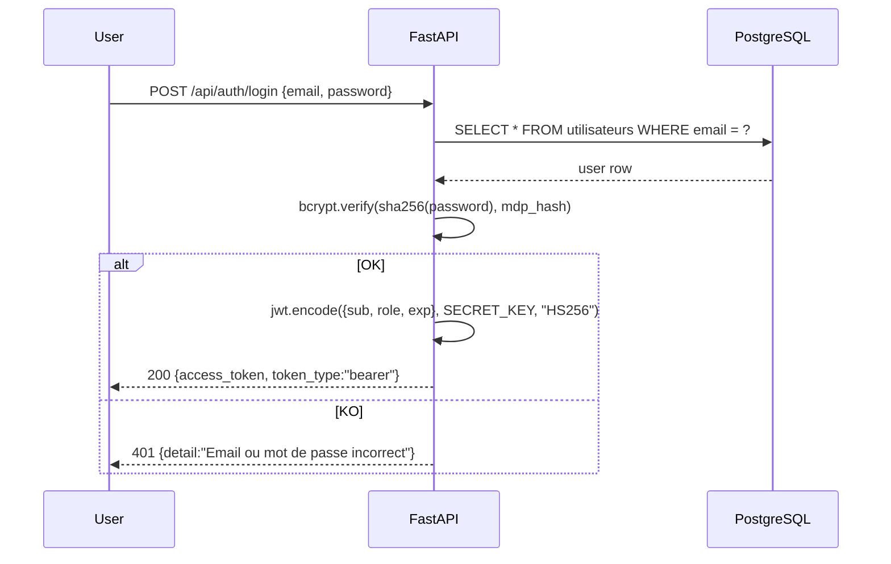
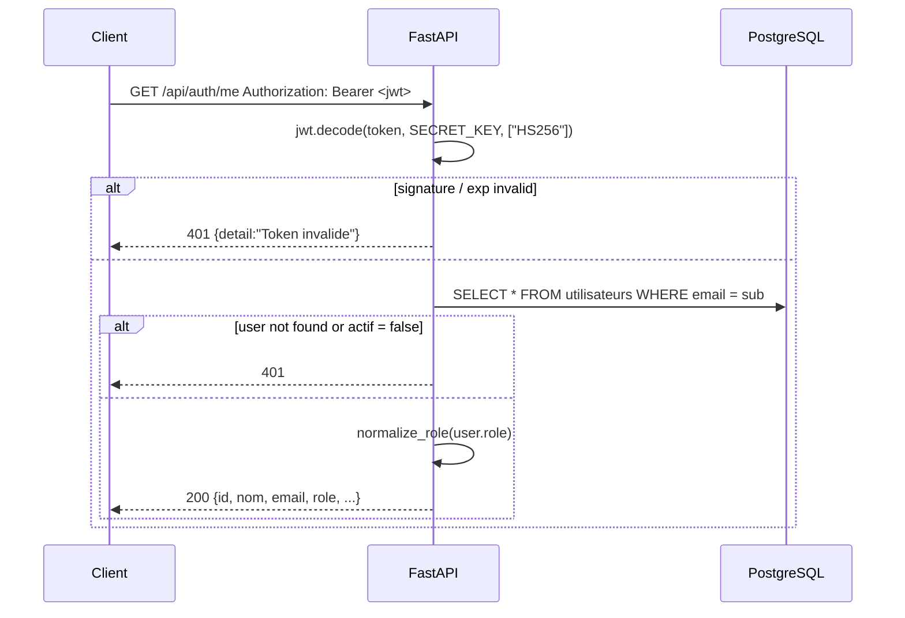

# :closed_lock_with_key: Security

> How MedAssist AI authenticates, authorises, and protects the API — and the gaps you should close before deploying to production.

---

## :lock: JWT authentication

MedAssist AI uses **stateless JWT bearer tokens** for the REST API. The WebSocket endpoint takes the same token via the `?token=` query parameter (browsers cannot set headers on the WS handshake).

**Algorithm:** HS256 (HMAC-SHA-256)

**Signing key:** `SECRET_KEY` from `.env` — must be at least 32 random characters in production.

**Lifetime:** `ACCESS_TOKEN_EXPIRE_MINUTES` (default `60`).

**Token contents (payload):**

```json
{
  "sub": "admin@chuoujda.ma",
  "role": "admin",
  "exp": 1735689600
}
```

**Issuer flow:**



**Verifier flow (dependency `get_current_user`):**



The same `get_current_user` dependency is used by every protected route. Tokens are **never** persisted server-side — invalidation requires waiting for the JWT to expire.

> :bulb: For multi-tenant / multi-instance deployments, consider switching to **RS256** with a key pair and rotating keys regularly.

---

## :key: Password hashing

Defined in `backend/app/auth.py`.

**Algorithm:** `bcrypt` over a **SHA-256 pre-hash** of the password.

```
stored = "sha256$" + bcrypt(sha256_utf8(password))
```

**Why the SHA-256 pre-hash?** Bcrypt silently truncates inputs longer than 72 bytes. Hashing once with SHA-256 first gives a fixed-length 32-byte input that bcrypt can hash deterministically, while still benefiting from bcrypt's adaptive cost.

```python
def hacher_mdp(mdp: str) -> str:
    mdp_normalise = hashlib.sha256(mdp.encode("utf-8")).digest()
    hash_bcrypt = bcrypt.hashpw(mdp_normalise, bcrypt.gensalt())
    return f"sha256${hash_bcrypt.decode('utf-8')}"

def verifier_mdp(mdp_brut: str, mdp_hash: str) -> bool:
    if mdp_hash.startswith("sha256$"):
        hash_bcrypt = mdp_hash.removeprefix("sha256$").encode("utf-8")
        return bcrypt.checkpw(_normaliser_mdp(mdp_brut), hash_bcrypt)
    # Legacy: plain bcrypt (kept for back-compat with old rows)
    return bcrypt.checkpw(mdp_brut.encode("utf-8"), mdp_hash.encode("utf-8"))
```

**Verification** is constant-time (handled by `bcrypt.checkpw`).

> :warning: The project does **not** enforce a password complexity policy at registration (`POST /api/auth/register`). Add one before any non-development deployment.

---

## :bust_in_silhouette: Role-based authorisation

Three roles, normalised to a single canonical form at the boundary:

| Canonical role     | Legacy aliases (auto-mapped)              | Privileges                                                |
| ------------------ | ----------------------------------------- | --------------------------------------------------------- |
| `admin`            | `Admin`                                   | Full access — including device registry, user & doc mgmt  |
| `hospital_staff`   | `Soignant`, `Technicien`                  | Dashboard, mesures, alertes (treat), chat, documents (read) |
| `visitor`          | `Patient`, `Visiteur`                     | Dashboard, chat only                                      |

**FastAPI dependencies** (in `backend/app/auth.py`):

```python
require_admin              # admin only
require_hospital_staff     # admin OR hospital_staff
require_visitor            # any known role
require_authenticated      # any authenticated user
require_roles(*roles)      # custom set
```

| Endpoint group                          | Guard                                  |
| --------------------------------------- | -------------------------------------- |
| `/api/auth/*`                           | none (login/register are public)       |
| `/api/capteurs/`, `/api/mesures/`       | `require_hospital_staff`               |
| `/api/alertes/` (read, treat)           | `require_hospital_staff`               |
| `/api/alertes/{id}` (DELETE)            | `require_admin`                        |
| `/api/alertes/bulk-delete`              | `require_admin`                        |
| `/api/documents/` (read, download)      | `require_hospital_staff`               |
| `/api/documents/` (upload, delete, patch) | `require_admin`                      |
| `/api/chat/`                            | `require_authenticated` (all roles)    |
| `/api/chat/interpreter`                 | `require_hospital_staff`               |
| `/api/admin/esp32/` (read)              | `require_hospital_staff`               |
| `/api/admin/esp32/` (mutate)            | `require_admin`                        |
| `/api/realtime/ws`                      | JWT in `?token=`                       |

> :bulb: A user with `actif = false` is rejected by `get_current_user` (HTTP 401) — soft-disable without deleting the row.

---

## :globe_with_meridians: CORS

```python
app.add_middleware(
    CORSMiddleware,
    allow_origins=["http://localhost:5173", "http://localhost:3000", "*"],
    allow_credentials=True,
    allow_methods=["*"],
    allow_headers=["*"],
)
```

| Setting               | Value                                       | Note                                |
| --------------------- | ------------------------------------------- | ----------------------------------- |
| `allow_origins`       | localhost dev ports + `*`                   | Restrict in production              |
| `allow_credentials`   | `True`                                      | Cookies / `Authorization` accepted  |
| `allow_methods`       | `*`                                         | All methods                         |
| `allow_headers`       | `*`                                         | All headers                         |

> :warning: The wildcard `*` makes the backend callable from any origin. **Lock it down** to your real frontend origin (e.g. `https://medassist.example.org`) before exposing the API.

---

## :shield: API protection summary

| Vector                            | Status          | Notes                                                                  |
| --------------------------------- | --------------- | ---------------------------------------------------------------------- |
| Auth on REST                      | :white_check_mark: Bearer JWT                                                |
| Auth on WebSocket                 | :white_check_mark: `?token=` query param                                    |
| Role-based authorisation          | :white_check_mark: dependency-guarded routes                                |
| Password hashing                  | :white_check_mark: SHA-256 + bcrypt                                        |
| CORS                              | :warning: Open in dev (`*`) — restrict in prod                              |
| HTTPS                             | :x: Not terminated by the stack — set up a reverse proxy                 |
| Rate limiting                     | :x: Not implemented                                                       |
| Account lockout / brute-force     | :x: Not implemented                                                       |
| Audit log                         | :x: Not implemented                                                       |
| MQTT broker authentication        | :x: Currently open (no-auth)                                              |
| Secret management                 | :warning: `.env` in repo for dev only — externalise for prod             |

---

## :construction: TODO — security work to do

The following items are **not** implemented yet. They are listed in priority order.

- [ ] **CORS allowlist** — drop `*`, set the real frontend origin
- [ ] **HTTPS termination** — Caddy / Traefik / nginx + Let's Encrypt
- [ ] **MQTT authentication** — username/password on Mosquitto, mirror in `MQTT_USERNAME` / `MQTT_PASSWORD`
- [ ] **Password policy** — minimum length, complexity, optional rotation
- [ ] **Rate limiting** — `slowapi` or nginx `limit_req` on `/api/auth/login`
- [ ] **Audit log** — append-only table of `who did what when`
- [ ] **Externalised secrets** — Vault / AWS Secrets Manager / Doppler instead of `.env`
- [ ] **JWT hardening** — switch to RS256, key rotation, shorter TTL + refresh tokens
- [ ] **WebSocket origin check** — verify the `Origin` header on the WS handshake
- [ ] **Database backups encrypted at rest**
- [ ] **Linting of user input** — already done for Pydantic models and `ip` validators, but extend to MQTT payloads if exposed further

> :information_source: This is a roadmap, not a promise. Track progress via the [GitHub issues](https://github.com/t4lhawi/MedAssist-AI/issues).
