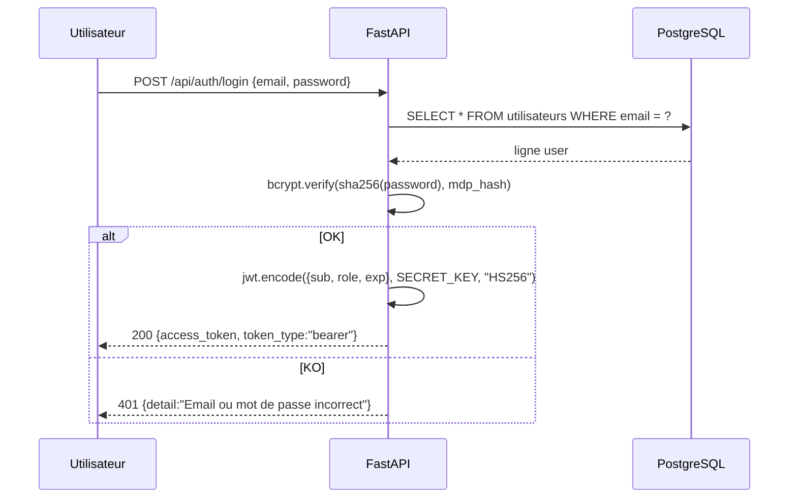
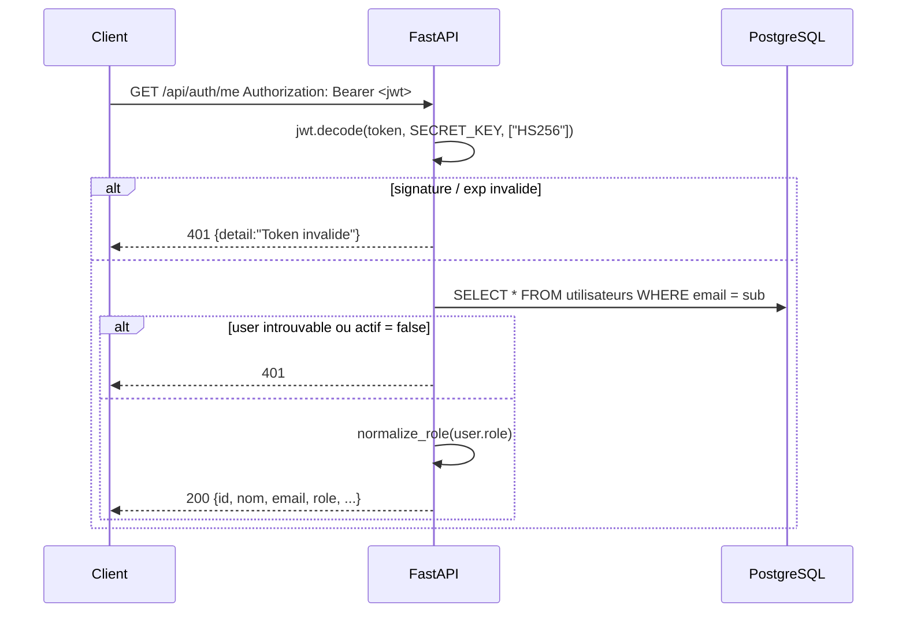

# Sécurité

> Comment MedAssist AI authentifie, autorise et protège l'API — et les failles à combler avant tout déploiement en production.

---

## Authentification JWT

MedAssist AI utilise des **jetons JWT stateless bearer** pour l'API REST. L'endpoint WebSocket récupère le même jeton via le paramètre de query `?token=` (les navigateurs ne peuvent pas définir d'en-têtes sur le handshake WS).

**Algorithme :** HS256 (HMAC-SHA-256)

**Clé de signature :** `SECRET_KEY` depuis `.env` — au moins 32 caractères aléatoires en production.

**Durée de vie :** `ACCESS_TOKEN_EXPIRE_MINUTES` (défaut `60`).

**Contenu du jeton (payload) :**

```json
{
  "sub": "admin@chuoujda.ma",
  "role": "admin",
  "exp": 1735689600
}
```

**Flux émetteur :**



**Flux vérificateur (dépendance `get_current_user`) :**



La même dépendance `get_current_user` est utilisée par chaque route protégée. Les jetons ne sont **jamais** persistés côté serveur — l'invalidation nécessite d'attendre l'expiration du JWT.

> **Astuce :** pour les déploiements multi-tenant / multi-instance, envisagez de passer à **RS256** avec une paire de clés et de les faire tourner régulièrement.

---

## Hachage des mots de passe

Défini dans `backend/app/auth.py`.

**Algorithme :** `bcrypt` sur un **pré-hash SHA-256** du mot de passe.

```
stocké = "sha256$" + bcrypt(sha256_utf8(password))
```

**Pourquoi le pré-hash SHA-256 ?** Bcrypt tronque silencieusement les entrées de plus de 72 octets. Hacher une première fois avec SHA-256 donne une entrée fixe de 32 octets que bcrypt peut hacher de manière déterministe, tout en bénéficiant du coût adaptatif de bcrypt.

```python
def hacher_mdp(mdp: str) -> str:
    mdp_normalise = hashlib.sha256(mdp.encode("utf-8")).digest()
    hash_bcrypt = bcrypt.hashpw(mdp_normalise, bcrypt.gensalt())
    return f"sha256${hash_bcrypt.decode('utf-8')}"

def verifier_mdp(mdp_brut: str, mdp_hash: str) -> bool:
    if mdp_hash.startswith("sha256$"):
        hash_bcrypt = mdp_hash.removeprefix("sha256$").encode("utf-8")
        return bcrypt.checkpw(_normaliser_mdp(mdp_brut), hash_bcrypt)
    # Legacy : bcrypt brut (gardé pour la rétro-compat des anciennes lignes)
    return bcrypt.checkpw(mdp_brut.encode("utf-8"), mdp_hash.encode("utf-8"))
```

**La vérification** est en temps constant (gérée par `bcrypt.checkpw`).

> **Avertissement :** le projet **n'applique pas** de politique de complexité de mot de passe à l'enregistrement (`POST /api/auth/register`). Ajoutez-en une avant tout déploiement hors développement.

---

## Autorisation par rôles

Trois rôles, normalisés vers une forme canonique unique à la frontière :

| Rôle canonique     | Aliases legacy (auto-mappés)          | Privilèges                                                              |
| ------------------ | ------------------------------------- | ----------------------------------------------------------------------- |
| `admin`            | `Admin`                               | Accès complet — y compris registre devices, gestion users & docs        |
| `hospital_staff`   | `Soignant`, `Technicien`              | Tableau de bord, mesures, alertes (traiter), chat, documents (lecture)  |
| `visitor`          | `Patient`, `Visiteur`                 | Tableau de bord, chat uniquement                                        |

**Dépendances FastAPI** (dans `backend/app/auth.py`) :

```python
require_admin              # admin uniquement
require_hospital_staff     # admin OU hospital_staff
require_visitor            # tout rôle connu
require_authenticated      # tout utilisateur authentifié
require_roles(*roles)      # ensemble personnalisé
```

| Groupe d'endpoints                       | Garde                                    |
| ---------------------------------------- | ---------------------------------------- |
| `/api/auth/*`                            | aucune (login/register sont publics)     |
| `/api/capteurs/`, `/api/mesures/`        | `require_hospital_staff`                 |
| `/api/alertes/` (lecture, traiter)       | `require_hospital_staff`                 |
| `/api/alertes/{id}` (DELETE)             | `require_admin`                          |
| `/api/alertes/bulk-delete`               | `require_admin`                          |
| `/api/documents/` (lecture, download)    | `require_hospital_staff`                 |
| `/api/documents/` (upload, delete, patch) | `require_admin`                         |
| `/api/chat/`                             | `require_authenticated` (tous les rôles) |
| `/api/chat/interpreter`                  | `require_hospital_staff`                 |
| `/api/admin/esp32/` (lecture)            | `require_hospital_staff`                 |
| `/api/admin/esp32/` (mutations)          | `require_admin`                          |
| `/api/realtime/ws`                       | JWT dans `?token=`                       |

> **Astuce :** un utilisateur avec `actif = false` est rejeté par `get_current_user` (HTTP 401) — désactivation douce sans supprimer la ligne.

---

## CORS

```python
app.add_middleware(
    CORSMiddleware,
    allow_origins=["http://localhost:5173", "http://localhost:3000", "*"],
    allow_credentials=True,
    allow_methods=["*"],
    allow_headers=["*"],
)
```

| Réglage               | Valeur                                       | Note                                |
| --------------------- | -------------------------------------------- | ----------------------------------- |
| `allow_origins`       | ports dev localhost + `*`                    | Restreindre en production           |
| `allow_credentials`   | `True`                                       | Cookies / `Authorization` acceptés  |
| `allow_methods`       | `*`                                          | Toutes méthodes                     |
| `allow_headers`       | `*`                                          | Tous les en-têtes                   |

> **Avertissement :** le wildcard `*` rend le backend appelable depuis n'importe quelle origine. **Verrouillez-le** sur l'origine réelle de votre frontend (par ex. `https://medassist.example.org`) avant d'exposer l'API.

---

## Résumé de la protection de l'API

| Vecteur                            | État         | Notes                                                                  |
| ---------------------------------- | ------------ | ---------------------------------------------------------------------- |
| Auth sur REST                      | OK           | Bearer JWT                                                             |
| Auth sur WebSocket                 | OK           | paramètre de query `?token=`                                           |
| Autorisation par rôle              | OK           | routes gardées par dépendances                                         |
| Hachage des mots de passe          | OK           | SHA-256 + bcrypt                                                       |
| CORS                               | À durcir     | ouvert en dev (`*`) — restreindre en prod                              |
| HTTPS                              | Non          | non terminé par la stack — mettre en place un reverse proxy            |
| Rate limiting                      | Non          | non implémenté                                                         |
| Verrouillage de compte / brute-force| Non          | non implémenté                                                         |
| Journal d'audit                    | Non          | non implémenté                                                         |
| Authentification broker MQTT       | Non          | actuellement ouvert (no-auth)                                          |
| Gestion des secrets                | À durcir     | `.env` dans le repo pour le dev — externaliser pour la prod            |

---

## TODO — travaux de sécurité à mener

Les éléments suivants **ne sont pas encore** implémentés. Ils sont listés par ordre de priorité.

- [ ] **Allowlist CORS** — retirer `*`, définir l'origine frontend réelle
- [ ] **Terminaison HTTPS** — Caddy / Traefik / nginx + Let's Encrypt
- [ ] **Authentification MQTT** — username/password sur Mosquitto, miroir dans `MQTT_USERNAME` / `MQTT_PASSWORD`
- [ ] **Politique de mot de passe** — longueur minimale, complexité, rotation optionnelle
- [ ] **Rate limiting** — `slowapi` ou nginx `limit_req` sur `/api/auth/login`
- [ ] **Journal d'audit** — table append-only de *qui a fait quoi quand*
- [ ] **Secrets externalisés** — Vault / AWS Secrets Manager / Doppler au lieu de `.env`
- [ ] **Durcissement JWT** — passer en RS256, rotation de clés, TTL plus court + refresh tokens
- [ ] **Vérification d'origine WebSocket** — valider l'en-tête `Origin` sur le handshake WS
- [ ] **Sauvegardes de la base de données chiffrées au repos**
- [ ] **Validation plus stricte des entrées utilisateur** — déjà fait pour les modèles Pydantic et les validateurs `ip`, mais à étendre aux payloads MQTT s'ils sont davantage exposés

> **Note :** ceci est une feuille de route, pas une promesse. Suivez la progression via les [issues GitHub](https://github.com/t4lhawi/MedAssist-AI/issues).
